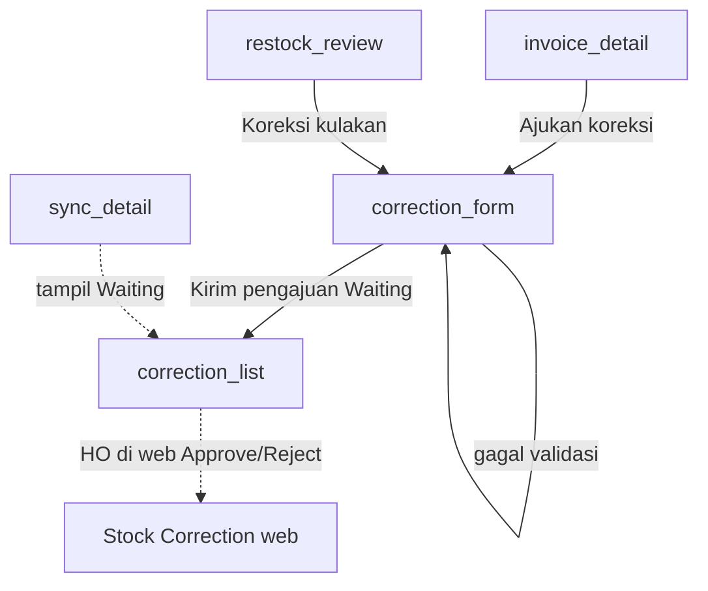

# Penjualan — Koreksi Stok (Mobile)

## Ringkasan

Di mobile, motoris **mengajukan** koreksi stok (status **Waiting**). Dokumen sumber (faktur / kulakan) tidak diubah. Persetujuan: **ABM/BHO di mobile** atau **HO di web**. Data memakai key `localStorage` yang sama: `fprs_koreksi_v1`.

Detail Approve/Reject: [penjualan_koreksi_persetujuan.md](./penjualan_koreksi_persetujuan.md).

| Aspek | Isi |
|-------|-----|
| Bahasa UI | Indonesia |
| Scope | Static HTML + `SfaStore` / `localStorage` |
| Model | Header + `lines[]` (multi-produk), satuan **pcs** |
| Status submit | Selalu **Waiting**, `requester: "Motoris"` |
| Efek saldo | **Belum** bergerak sampai HO Approve di web |

Dokumen web pasangan: [../../web/pages/penjualan_koreksi.md](../../web/pages/penjualan_koreksi.md)

---

## Path & entry point

| Halaman | File |
|---------|------|
| Form pengajuan | `Views/Mobile/correction_form.html` |
| Daftar milik saya | `Views/Mobile/correction_list.html` |
| Persetujuan ABM/BHO | `Views/Mobile/correction_approve.html` — Setujui/Tolak di kartu + detail; docs [penjualan_koreksi_persetujuan.md](./penjualan_koreksi_persetujuan.md) |
| Entry dari faktur | `Views/Mobile/invoice_detail.html` → **Ajukan koreksi** |
| Entry dari kulakan | `Views/Mobile/restock_review.html` → link ke form `?source=kulakan` |
| Antrean visual | `Views/Mobile/sync_detail.html` (item Waiting requester Motoris) |

**Base URL (contoh):** `http://127.0.0.1:5501/Views/Mobile/`

### Query form

| Param | Nilai | Efek |
|-------|-------|------|
| `source` | `invoice` (default) \| `kulakan` | Sumber dokumen |
| `id` | id faktur SFA | Wajib untuk `source=invoice` |

Contoh:

- `correction_form.html?source=invoice&id=…`
- `correction_form.html?source=kulakan`

---

## Alur pengguna

1. Motoris buka faktur / selesai review kulakan.
2. Isi **Qty benar** hanya untuk produk yang salah; isi **Alasan**.
3. **Kirim pengajuan** → record Waiting di `fprs_koreksi_v1`.
4. Sukses → `correction_list.html` (*Menunggu persetujuan HO. Saldo belum berubah.*).
5. HO approve/reject di web; daftar mobile & antrean sync merefleksikan status (reload).

---

## 1. Form — `correction_form.html`

### UI (UX lapangan)

| Blok | Isi |
|------|-----|
| Header | Judul **Ajukan Koreksi**, back |
| Kartu dokumen | Nomor dokumen + Outlet/Stokis (readonly / `.locked`) |
| Kartu produk | Nama + harga ringkas; **Asli: N**; **Qty benar** dengan stepper ± + input; dampak live (`−2 pcs · Rp …`); baris berubah di-highlight |
| Alasan | Chip cepat (*Salah hitung*, *Kurang kirim*, *Lebih kirim*, *Retur di tempat*) + textarea (placeholder *Kenapa qty berbeda?*) |
| Sticky bottom | **Kirim pengajuan** — disabled sampai ada delta + alasan; confirm Swal sebelum submit |
| Empty / ID salah | Pesan jelas + tombol **Kembali**; kartu alasan & Kirim disembunyikan |

Hint: *Harga mengikuti baris asli. Ubah qty benar hanya untuk produk yang dikoreksi.*

### Load data

**Invoice** (`loadInvoice`):

- Baca `SfaStore.getInvoices()` by `id`.
- `sourceNo` = `invoiceNo` atau `INV-{id}`.
- `party` = nama pelanggan.
- Agregasi item: qty pcs (`qtyPcs` atau UOM PCS) per kode produk; harga dari baris.

**Kulakan** (`loadKulakan`):

- `temp_restock_adjustments` → baris dengan `addPcs > 0`.
- `temp_restock_grosir` → label party.
- `temp_restock_docno` → nomor dokumen (`KL-YYYYMMDD` di-generate jika belum ada).
- Harga dari `SfaStore.getProductById`.

### Submit

Memanggil `SfaStore.submitMotorisCorrection({…})` dengan:

- `sourceType`, `sourceNo`, `motoris` (user login), `partyLabel`, `reason`, `lines` (hanya delta ≠ 0).

Pesan error UI (contoh):

| Kondisi | Pesan |
|---------|-------|
| Qty bukan bilangan bulat ≥ 0 | *Qty benar harus bilangan bulat dan tidak boleh minus.* |
| Tidak ada perubahan | *Ubah minimal satu qty pcs.* |
| Minus > qty asli | *Minus tidak boleh lebih besar dari qty asli.* |
| Alasan kosong | *Alasan wajib diisi.* |
| Sudah ada Waiting untuk `sourceNo` | *Dokumen ini sudah punya koreksi yang menunggu.* |

Sukses Swal → navigasi ke `correction_list.html`.

---

## 2. List — `correction_list.html`

### Filter tampilan

`SfaStore.listCorrections()` lalu filter:

- `requester === 'Motoris'`
- `motoris` cocok dengan user login (jika nama tersedia)

Urutan: terbaru di atas (`reverse`).

### Kartu per koreksi

| Elemen | Isi |
|--------|-----|
| Nomor | `id` (mis. `KR-2026-0002`) |
| Pill status | Menunggu / Disetujui / Ditolak |
| Source | `sourceNo` |
| Ringkas | `{n} produk` |
| Alasan | teks reason |

Empty: *Belum ada pengajuan koreksi.*

Tidak ada drill-down detail di prototipe ini (read-only list).

### Pill status

| Status data | Label UI | Class |
|-------------|----------|-------|
| Waiting | Menunggu | `pill-wait` (oranye) |
| Approved | Disetujui | `pill-ok` (hijau) |
| Rejected | Ditolak | `pill-no` (abu) |

---

## 3. Entry points lain

### `invoice_detail.html`

- Tombol **Ajukan koreksi** → `correction_form.html?source=invoice&id={invoiceId}`.
- Fungsi `ajukanKoreksi()` memakai `window._corrInvId`.

### `restock_review.html`

- CTA sekunder ke `correction_form.html?source=kulakan` (mengandalkan temp restock di `localStorage`).

### `sync_detail.html`

- Selain antrean `sfa_sync_queue`, menampilkan koreksi **Waiting** + `requester === 'Motoris'` sebagai item visual:
  - Judul: `Koreksi {sourceNo}`
  - Sub: `{n} produk · menunggu persetujuan`
  - Icon `icon-correction` (oranye)
- **Bukan** item sync API terpisah di prototipe — hanya indikator menunggu HO. Approve di web menghilangkan item Waiting dari daftar ini setelah reload.

---

## Data layer — `SfaStore`

| API | Peran |
|-----|--------|
| `listCorrections()` | Baca `fprs_koreksi_v1` |
| `writeCorrections(list)` | Tulis ulang array (internal) |
| `submitMotorisCorrection(input)` | Validasi + append Waiting |
| `nextCorrectionId(list)` | `KR-2026-####` |

Key storage: **`fprs_koreksi_v1`** — **sama** dengan web Stock Correction. Origin prototipe harus sama (mis. keduanya `127.0.0.1:8766` atau keduanya Live Server) agar list web melihat pengajuan mobile.

Shape record sama dengan web (lihat dokumen web § Model data): header + `lines[]` dengan `deltaPcs`, `value`, dll.

---

## Aturan bisnis (mobile)

| Aturan | Perilaku |
|--------|----------|
| Role | Pengajuan dari motoris lapangan |
| Status awal | Waiting saja (bukan auto-Approved) |
| Saldo | Tidak bergerak di perangkat; baru setelah Approve web |
| Multi-produk | Satu pengajuan bisa banyak line; hanya yang berubah |
| Satuan | pcs |
| Harga | Dari dokumen / master produk; tidak diedit |
| Satu Waiting / sumber | Ditolak jika `sourceNo` sudah punya Waiting |
| Alasan | Wajib |
| Minus | Tidak boleh melebihi qty asli |

---

## Persetujuan mobile (ABM / BHO)

Kebutuhan lapangan: ABM/BHO sering tidak di depan web HO, sementara pengajuan Waiting dari motoris butuh putusan cepat agar saldo benar.

| Aspek | Keputusan prototipe |
|-------|---------------------|
| Menu | Beranda → **Persetujuan Koreksi** (label `for ABM / BHO` + `New Feature` tetap untuk notice) |
| Role demo | Login username diawali `abm` / `bho` → role tersebut (`SfaStore.resolveLoginRole`); `isCorrectionApprover()` |
| List | Chip **Menunggu** / **Riwayat** (20 terbaru); kartu ringkas → tap detail |
| Putusan | **Setujui** / **Tolak** di kartu list Waiting dan di detail (approver saja); confirm Swal |
| Non-approver | Boleh buka (mode lihat saja); aksi putusan disembunyikan |
| Jejak | `decidedBy`, `decidedRole`, `decidedAt` (additive; web abaikan field ekstra) |
| Storage | `fprs_koreksi_v1` via `listCorrections` / `writeCorrections` |
| Belum | Filter cabang/area, RBAC KNGlobal, bulk, push |

Web HO tetap jalur penuh (create + approve semua). Mobile approve ini pelengkap untuk antrian motoris di lapangan.

Demo cepat: login `abm01` → Persetujuan Koreksi → detail Waiting → Setujui.

## Perbedaan web vs mobile

| | Web HO | Mobile motoris | Mobile ABM/BHO (stub) |
|--|--------|----------------|------------------------|
| Bahasa UI | English | Indonesia | Indonesia |
| Create | Invoice LOV + **Approved** | Faktur/kulakan → **Waiting** | Tidak |
| Approve/Reject | Ya (semua) | Tidak | Ya (Waiting dari motoris) |
| Bulk | Ya | Tidak | Tidak |
| List | Semua + filter kartu | Punya sendiri | Waiting motoris |

---

## Smoke test manual

1. Login motoris → buka faktur yang punya baris pcs → **Ajukan koreksi**.
2. Stepper ± pada **Qty benar** → dampak Rp + highlight; tap chip alasan → **Kirim** enabled → confirm → list **Menunggu**.
3. Buka URL id faktur invalid → empty + **Kembali** (bukan form kosong).
4. Login `abm01` → Persetujuan Koreksi → detail Waiting → Setujui → list Menunggu berkurang; web Waiting turun.
5. Login motoris → buka Persetujuan Koreksi → mode lihat saja (tanpa Setujui/Tolak).
6. Reload `correction_list.html` motoris → pill **Disetujui**.
7. Ajukan lagi nomor sumber yang sama saat masih Waiting → ditolak.
8. Dari `restock_review` → form kulakan → submit Waiting.

---

## File terkait

| File | Peran |
|------|--------|
| `Views/Mobile/correction_form.html` | Form multi-line |
| `Views/Mobile/correction_list.html` | Riwayat milik motoris |
| `Views/Mobile/invoice_detail.html` | Entry invoice |
| `Views/Mobile/restock_review.html` | Entry kulakan |
| `Views/Mobile/sync_detail.html` | Indikator Waiting |
| `wwwroot/js/sfa-store.js` | `submitMotorisCorrection` / `listCorrections` |
| `Views/FPRS/Penjualan/Koreksi/index.html` | Approve / Reject / create HO |

---

## Batasan prototipe

- List mobile tidak membuka detail baris produk.
- Koreksi Waiting di sync_detail hanya visual, belum masuk pipeline `processQueue` sebagai tipe sync server.
- Reset `SfaStore.resetAndReseed()` **tidak** menghapus `fprs_koreksi_v1` (key terpisah dari `KEYS` SFA).
- Tidak ada push notifikasi saat HO memutuskan.

---

## Relasi dokumen

- Indeks halaman mobile: [README.md](./README.md)
- Overview mobile: [../sfa_mobile_prototype.md](../sfa_mobile_prototype.md)
- Detail faktur: [invoice_detail.md](./invoice_detail.md)
- Antrean sync: [sync_detail.md](./sync_detail.md)
- Web Stock Correction: [../../web/pages/penjualan_koreksi.md](../../web/pages/penjualan_koreksi.md)
