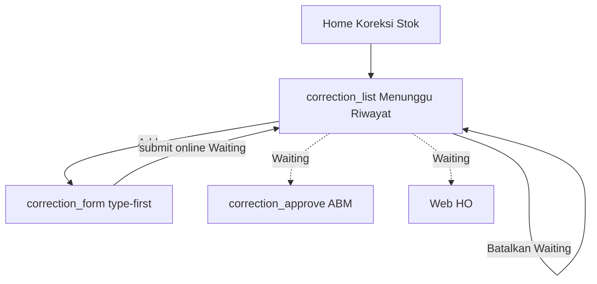

# Penjualan — Koreksi Stok (Mobile)

## Ringkasan

Motoris punya **hub Koreksi Stok** sendiri (online-only). Pengajuan status **Waiting**; dokumen sumber (faktur / kulakan) tidak diubah. Persetujuan: **ABM/BHO di mobile** atau **HO di web**. Storage: `localStorage` key **`fprs_koreksi_v1`**.

**Bukan** antrean upload / push sync: submit **tidak** memanggil `addToSyncQueue`; koreksi Waiting **tidak** tampil di `sync_detail.html`.

Detail Approve/Reject: [penjualan_koreksi_persetujuan.md](./penjualan_koreksi_persetujuan.md).  
Dokumen web: [../../web/pages/penjualan_koreksi.md](../../web/pages/penjualan_koreksi.md).

| Aspek | Isi |
|-------|-----|
| Bahasa UI | Indonesia |
| Scope | Static HTML + `SfaStore` / `localStorage` |
| Model | Header + `lines[]` (multi-produk), satuan **pcs** |
| Status submit | Selalu **Waiting**, `requester: "Motoris"` |
| Efek saldo | **Belum** bergerak sampai Approve |
| Koneksi | **Online wajib** (banner + blok Add / Batalkan / submit) |
| Sync | **Tidak** masuk `sfa_sync_queue` |

---

## Path & entry point

| Halaman | File |
|---------|------|
| Hub motoris | `Views/Mobile/correction_list.html` (Menunggu \| Riwayat + Add + Batalkan) |
| Form pengajuan | `Views/Mobile/correction_form.html` (type-first + LOV) |
| Persetujuan ABM/BHO | `Views/Mobile/correction_approve.html` — [penjualan_koreksi_persetujuan.md](./penjualan_koreksi_persetujuan.md) |
| Menu beranda | `Views/Mobile/home.html` → kartu **Koreksi Stok** (`menu-for-motoris`) |

**Tidak ada** shortcut dari `invoice_detail.html` / `restock_review.html` (dihapus). Query `?source=&id=` di form diabaikan / diganti ke form kosong.

**Base URL (contoh):** `http://127.0.0.1:5501/Views/Mobile/`

---

## Alur pengguna

1. Motoris (online) → Beranda → **Koreksi Stok**.
2. **Add** → pilih **Tipe** (Sales invoice / Kulakan) → LOV dokumen milik motoris → qty pcs + alasan → **Kirim** → Waiting.
3. Di **Menunggu**: **Batalkan** (confirm) menghapus record Waiting milik sendiri (tidak masuk Riwayat).
4. ABM/HO memutuskan; **Riwayat** menampilkan Approved/Rejected (max ~20).

Offline: banner *Fitur ini membutuhkan koneksi.* — Add / Batalkan / submit diblokir.

---

## 1. Hub — `correction_list.html`

Pola UX sejajar `correction_approve.html` (segment + kartu).

| Elemen | Perilaku |
|--------|----------|
| Segment **Menunggu** | `requester: Motoris` + milik user login + `status: Waiting` |
| Segment **Riwayat** | Approved/Rejected milik user; sort terbaru; max ~20 |
| **Add** | Header → `correction_form.html` (tanpa prefill); offline → Swal |
| Kartu Waiting | Meta + **Batalkan** (outline destructive); tap → detail read-only |
| Kartu Riwayat | Tanpa aksi putusan; tap → detail + jejak bila ada |
| Offline | Banner + blok Add / Batalkan |

### Batalkan

Confirm Swal → `SfaStore.cancelMotorisCorrection(id)` → **hapus** record Waiting milik sendiri (bukan status `Cancelled`; tidak masuk Riwayat).

---

## 2. Form — `correction_form.html`

### UI (type-first)

| Blok | Isi |
|------|-----|
| Header | **Ajukan Koreksi**, back ke hub |
| Offline bar | *Fitur ini membutuhkan koneksi.* |
| Tipe transaksi | Sales invoice (Outbound) / Kulakan (Inbound) |
| Dokumen | LOV search (sheet) — filter milik motoris login |
| Produk | Nama + harga; **Asli: N**; **Qty benar** stepper ±; dampak live |
| Alasan | Chip cepat + textarea |
| Sticky | **Kirim pengajuan** — disabled sampai delta + alasan + online |

Motoris diambil dari login (`SfaStore.getUser()`), bukan dipilih di form.

### Load data

**Invoice:** `SfaStore.getInvoices()` filter sales/motoris = user; agregasi qty pcs per produk.

**Kulakan:** fetch `wwwroot/data/kulakan.json` (cache `fprs_kulakan_v2`); filter nama longgar + fallback demo Yossy bila login belum nama penuh.

### Submit

`SfaStore.submitMotorisCorrection({…})` — **tidak** memanggil `addToSyncQueue`.

| Kondisi | Pesan |
|---------|-------|
| Offline | *Fitur ini membutuhkan koneksi.* |
| Qty invalid | *Qty benar harus bilangan bulat dan tidak boleh minus.* |
| Tidak ada perubahan | *Ubah minimal satu qty pcs.* |
| Minus > qty asli | *Minus tidak boleh lebih besar dari qty asli.* |
| Alasan kosong | *Alasan wajib diisi.* |
| Sudah ada Waiting untuk `sourceNo` | *Dokumen ini sudah punya koreksi yang menunggu.* |

Sukses Swal → `correction_list.html`. Teks sukses menyebut online / bukan antrean upload.

---

## Data layer — `SfaStore`

| API | Peran |
|-----|--------|
| `listCorrections()` | Baca `fprs_koreksi_v1` |
| `writeCorrections(list)` | Tulis ulang array |
| `submitMotorisCorrection(input)` | Validasi + append Waiting (**tanpa** sync queue) |
| `cancelMotorisCorrection(id)` | Hapus Waiting milik motoris login |
| `nextCorrectionId(list)` | `KR-2026-####` |

Shape record sama dengan web (header + `lines[]`).

---

## Aturan bisnis (mobile)

| Aturan | Perilaku |
|--------|----------|
| Role | Pengajuan dari motoris lapangan |
| Status awal | Waiting |
| Saldo | Tidak bergerak sampai Approve |
| Online | Wajib untuk Add / Batalkan / submit |
| Sync / push | Tidak masuk antrean upload |
| Multi-produk | Hanya baris yang berubah |
| Satuan | pcs |
| Satu Waiting / sumber | Ditolak jika `sourceNo` sudah Waiting |
| Batalkan | Hanya Waiting milik sendiri; hapus dari storage |

---

## Perbedaan web vs mobile

| | Web HO | Mobile motoris hub | Mobile ABM/BHO |
|--|--------|--------------------|----------------|
| Bahasa UI | English | Indonesia | Indonesia |
| Create | Type-first → LOV → **Approved** | Type-first → LOV → **Waiting** | Tidak |
| Batalkan Waiting | Tidak (pass ini) | Ya (milik sendiri) | Tidak — pakai Tolak |
| Approve/Reject | Ya | Tidak | Ya |
| Online admin | Ya (bukan offline SFA) | Online-only SFA | Online lapangan |
| Sync queue | Tidak | Tidak | Tidak |

---

## Smoke test manual

1. Login motoris (online) → **Koreksi Stok** → Menunggu kosong / list Waiting.
2. **Add** → tipe invoice → LOV → ubah qty + alasan → Kirim → muncul di Menunggu.
3. **Batalkan** → confirm → hilang dari Menunggu (bukan Riwayat).
4. Offline → banner; Add / Batalkan diblokir.
5. Submit Waiting → pastikan **tidak** muncul di Antrean Upload (`sync_detail`).
6. Login `abm01` → Persetujuan Koreksi → Setujui → motoris Riwayat **Disetujui**.
7. Faktur detail / restock review: **tidak** ada tombol Ajukan koreksi.

---

## File terkait

| File | Peran |
|------|--------|
| `Views/Mobile/correction_list.html` | Hub Menunggu / Riwayat |
| `Views/Mobile/correction_form.html` | Form type-first |
| `Views/Mobile/home.html` | Menu Koreksi Stok |
| `Views/Mobile/correction_approve.html` | Putusan ABM/BHO |
| `wwwroot/js/sfa-store.js` | submit / cancel / list |
| `Views/FPRS/Penjualan/Koreksi/index.html` | Web HO |

---

## Batasan prototipe

- Batalkan = hapus Waiting (bukan status Cancelled).
- Tidak ada offline draft / retry queue koreksi.
- Reset `SfaStore.resetAndReseed()` **tidak** menghapus `fprs_koreksi_v1`.
- Tidak ada push notifikasi saat HO/ABM memutuskan.

---

## Relasi dokumen

- Persetujuan: [penjualan_koreksi_persetujuan.md](./penjualan_koreksi_persetujuan.md)
- Beranda: [home.md](./home.md)
- Web Stock Correction: [../../web/pages/penjualan_koreksi.md](../../web/pages/penjualan_koreksi.md)
