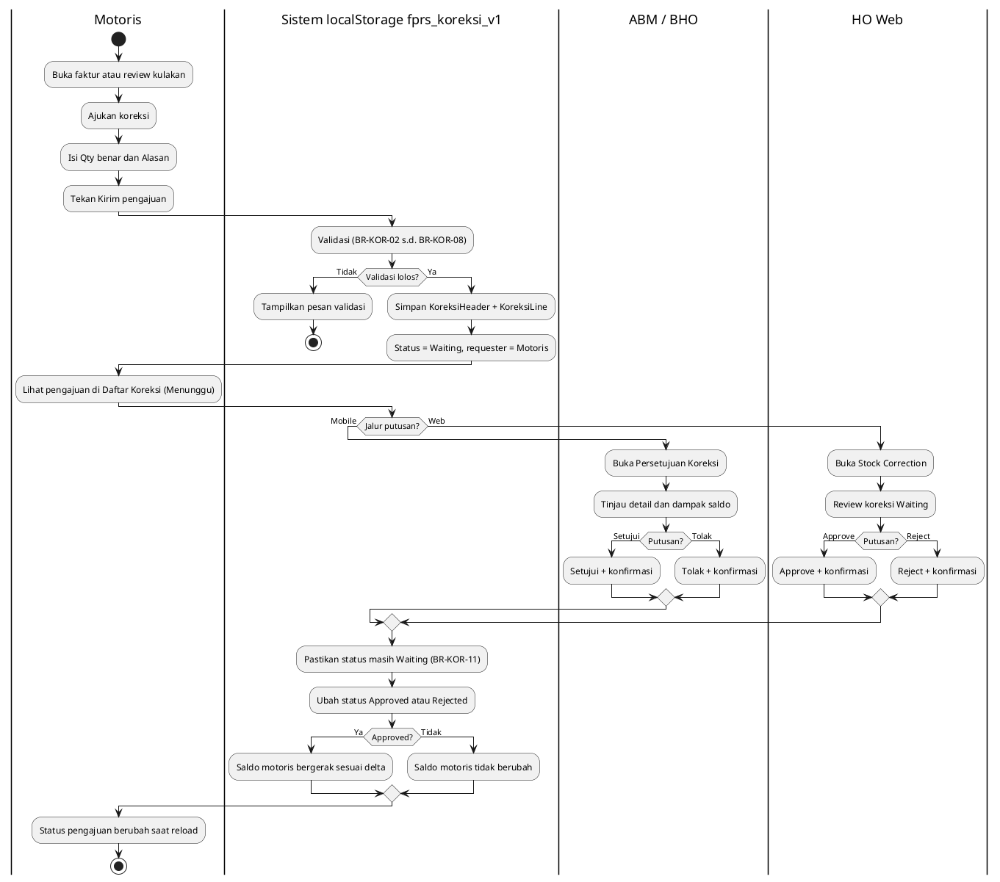
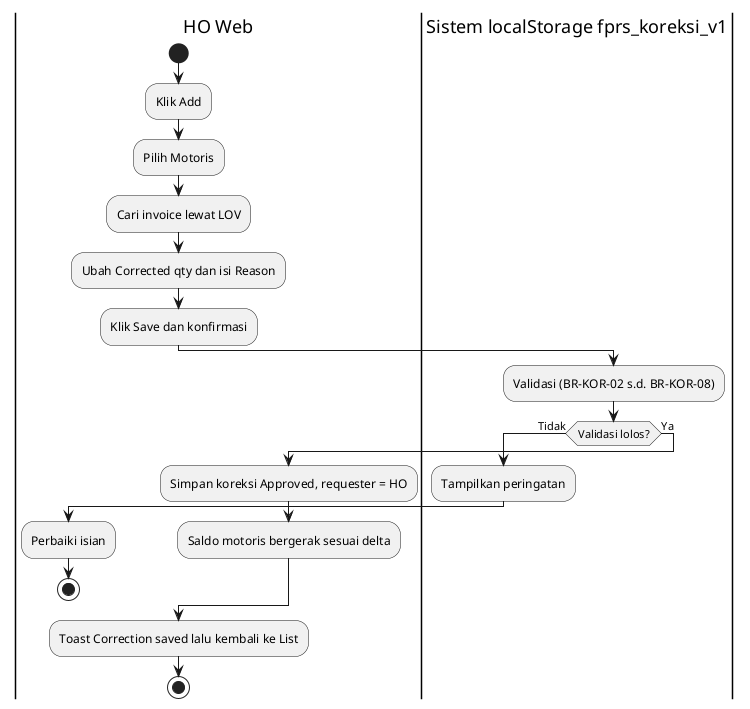
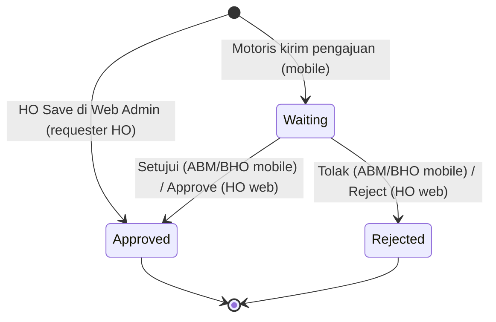
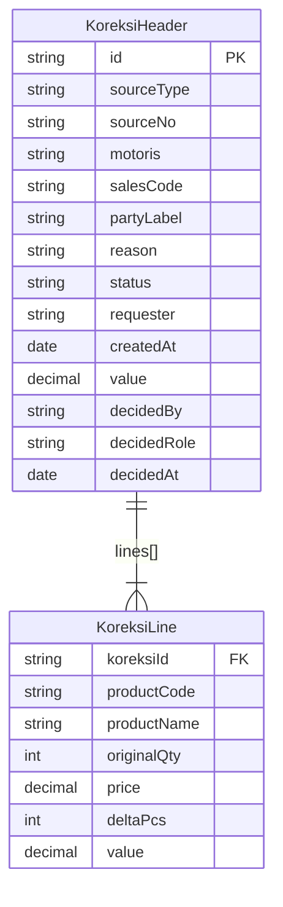

# FUNCTIONAL SPECIFICATION DOCUMENT (FSD)
## Modul: Man Power GT — Koreksi Stok (Web Admin & Mobile SFA)
### Sistem: Man Power GT
### Versi Dokumen: 1.0

---

| Atribut | Keterangan |
|---------|------------|
| **Nama Dokumen** | FSD Modul Koreksi Stok — Web Admin & Mobile SFA Man Power GT |
| **Versi** | 1.0 |
| **Tanggal** | 27 Oktober 2026 |
| **Divisi** | IT / Business – Man Power GT |
| **Status** | Draft |
| **Dibuat oleh** | Tim IT – Man Power GT |

---

## Riwayat Revisi

| Versi | Tanggal | Diubah Oleh | Keterangan |
|-------|---------|-------------|------------|
| **1.0** | **27 Oktober 2026** | **Tim IT** | Initial draft – Koreksi Stok (Web Admin *Stock Correction* + Mobile SFA pengajuan & persetujuan ABM/BHO); swimlane PlantUML, state diagram, ERD logis, BR-KOR-01–BR-KOR-15, RBAC, dan smoke UAT |

---

## Persetujuan Dokumen (Document Approval)

| Full Name | Job Title | Signature | Signature Date |
|-----------|-----------|-----------|----------------|
| Muhammad Rafi | SHP Channel & Customer Development |  |  |
| Silvester Mario Nian Destrada | SHP Channel & Customer Development |  |  |
| Aldira Rahmania | SHP Channel & Customer Development |  |  |
| Ageng Kurniawan Sugianto | IT Product |  |  |
| Albet | IT Product |  |  |

---

## 1. Pendahuluan

### 1.1 Latar Belakang

**Man Power GT** (*Man Power General Trade*) adalah sistem internal PT Kalbe Nutritionals untuk mengelola tenaga lapangan General Trade (motoris / canvasser), data master terkait, penjualan lapangan, dan pemantauan stok yang dibawa motoris.

Di lapangan, qty pada faktur penjualan atau dokumen kulakan (pengisian ulang barang dari stokis) kadang salah catat: salah hitung, kurang kirim, lebih kirim, atau retur di tempat. Dokumen sumber tidak boleh diubah karena sudah menjadi bukti transaksi. Karena itu dibutuhkan **transaksi koreksi stok yang berdiri sendiri**: dokumen sumber tetap utuh, sedangkan selisih qty (delta) dicatat sebagai dokumen koreksi lengkap dengan alasan dan status persetujuan.

Modul **Koreksi Stok** terdiri dari dua sisi yang memakai data yang sama:

1. **Mobile SFA** — motoris **mengajukan** koreksi (status **Waiting**). Pengajuan diputuskan oleh **ABM / BHO** langsung di mobile, atau oleh **HO** di Web Admin.
2. **Web Admin (Stock Correction)** — HO memantau seluruh koreksi, membuat koreksi langsung (otomatis **Approved**), serta menyetujui / menolak pengajuan Waiting, termasuk secara massal.

Saldo stok motoris **hanya bergerak setelah koreksi berstatus Approved**.

### 1.2 Tujuan Dokumen

1. Mendeskripsikan fungsionalitas **per halaman dan per komponen UI** modul Koreksi Stok (Web dan Mobile).
2. Menjadi acuan pengembangan dan UAT untuk koreksi stok Man Power GT.
3. Mendokumentasikan business rules (**BR-KOR-01** s.d. **BR-KOR-15**), pola akses (RBAC), dan struktur data (header + baris koreksi).
4. Mendokumentasikan kontrak data prototipe (`localStorage`) sebagai acuan implementasi database MAVEN; nama tabel fisik **[TBD]**.
5. Menyelaraskan format dokumentasi dengan standar FSD Kalbe Nutritionals (FSD Generator Engine).

### 1.3 Ruang Lingkup

| Dalam lingkup | Di luar lingkup |
|---------------|-----------------|
| Web Admin — daftar koreksi (kartu filter, DataTable, bulk Approve all / Reject all) | Mengubah / menghapus dokumen sumber (faktur / kulakan) |
| Web Admin — buat koreksi dari faktur (pilih motoris, LOV invoice, edit Corrected qty) | Create koreksi dari **kulakan** di Web Admin (hanya faktur pada pass ini) |
| Web Admin — review koreksi, Approve / Reject saat Waiting | Edit atau hapus koreksi yang sudah dibuat (tidak ada Update / Delete) |
| Mobile SFA — form **Ajukan Koreksi** (faktur dan kulakan), daftar pengajuan milik motoris | Satuan selain **pcs** (karton / dus) |
| Mobile SFA — **Persetujuan Koreksi** untuk ABM / BHO (Menunggu, Riwayat, detail, Setujui / Tolak) | Bulk approve di mobile |
| Efek ke saldo Stok Motoris dan overlay Faktur (pembaca data Approved) | Filter cabang / area untuk ABM / BHO |
| RBAC target dan jejak putusan | RBAC KNGlobal production (enforcement) |
| Struktur data logis + ERD; DB fisik MAVEN **[TBD]** | Push notifikasi ke approver / motoris |
| Smoke test UAT | Alasan wajib saat Reject (opsional produk nanti) |

### 1.4 Stakeholder

| Peran | Tim/Divisi | Keterlibatan |
|-------|------------|--------------|
| Motoris | Sales lapangan | Mengajukan koreksi dari Mobile SFA; melihat status pengajuan sendiri |
| ABM / BHO | Sales lapangan (supervisor) | Menyetujui / menolak pengajuan Waiting dari motoris di Mobile SFA |
| HO (Admin) | SHP Channel & Customer Development | Monitoring, create koreksi langsung, Approve / Reject (single & bulk) di Web Admin |
| Super Admin | IT | Akses seluruh menu & data |
| Developer | IT Product | Implementasi API & UI database (MAVEN) |

### 1.5 Glosarium

| Istilah | Arti sederhana |
|---------|----------------|
| **ABM** | Peran supervisor lapangan yang berwenang memutuskan pengajuan koreksi di mobile. |
| **Approved** | Koreksi disetujui; saldo stok motoris dianggap bergerak sesuai delta. |
| **BHO** | Peran pejabat cabang yang berwenang memutuskan pengajuan koreksi di mobile (setara ABM untuk alur persetujuan). |
| **Correction No.** | Nomor dokumen koreksi, format `KR-2026-####` (mis. `KR-2026-0002`). |
| **Delta (pcs)** | Selisih qty: `Corrected qty − Original qty`. Negatif (minus) mengurangi, positif (plus) menambah. |
| **Dokumen sumber** | Faktur penjualan atau dokumen kulakan yang dikoreksi. Tidak pernah diubah oleh modul ini. |
| **Faktur (Invoice)** | Bukti penjualan motoris ke outlet. Dipakai sebagai sumber koreksi. |
| **HO** | *Head Office* — pengguna Web Admin pusat. |
| **Kulakan** | Stok masuk ke motoris dari stokis (pengisian ulang barang). Dipakai sebagai sumber koreksi di mobile. |
| **LOV** | *List of Values* — pop-up daftar pilihan (di sini: daftar faktur milik motoris terpilih). |
| **Motoris** | Tenaga penjualan lapangan yang berkeliling dengan motor (canvasser). |
| **Net value** | Jumlah nilai seluruh baris koreksi: Σ `lines[].value`. |
| **Original qty** | Qty pcs pada dokumen sumber (snapshot saat koreksi dibuat). |
| **Corrected qty / Qty benar** | Qty pcs yang benar menurut pengguna; delta dihitung dari selisihnya terhadap Original qty. |
| **Outlet / Stokis** | Pihak lawan transaksi: toko (untuk faktur) atau stokis (untuk kulakan); tersimpan sebagai `partyLabel`. |
| **pcs** | Satuan terkecil produk. Koreksi hanya dalam pcs. |
| **Rejected** | Koreksi ditolak; saldo tidak berubah. |
| **requester** | Asal pengajuan: `Motoris` (mobile) atau `HO` (web). |
| **RBAC** | Pengaturan hak akses berdasarkan peran. |
| **Saldo stok motoris** | Sisa stok yang masih dibawa motoris setelah kulakan, penjualan, dan koreksi Approved. |
| **SFA** | *Sales Force Automation* — aplikasi mobile sales lapangan. |
| **Snapshot** | Salinan nilai (qty, harga) dari dokumen sumber saat koreksi dibuat, agar tidak berubah mengikuti sumber. |
| **Stok Motoris** | Modul Web Admin pemantauan stok & aktivitas motoris. |
| **UAT** | *User Acceptance Test* — uji penerimaan oleh pengguna bisnis. |
| **Waiting** | Pengajuan menunggu putusan; saldo belum berubah. |

---

## 2. Arsitektur & Alur Koreksi Stok

### 2.1 Ringkasan Teknis

| Aspek | Prototipe | Database (MAVEN) |
|-------|-----------|------------------|
| Arsitektur | Static HTML — Web `Views/FPRS/Penjualan/Koreksi/index.html` (single page, tiga mode); Mobile `Views/Mobile/correction_*.html` | ASP.NET Core MVC + service layer + API controller **[TBD]** |
| UI Framework | Bootstrap 5.3, Vuexy (web); halaman mobile SFA bertema hijau `#005D41` | Vuexy + Razor Views (web); mobile mengikuti aplikasi SFA |
| JavaScript | jQuery, DataTables, Select2, SweetAlert2, `prototype-spa.js` (web); `sfa-store.js` (mobile) | Sama / setara |
| Persistensi | `localStorage` key `fprs_koreksi_v1` (dibagi web + mobile pada origin yang sama), `fprs_koreksi_v2` (flag seed), `fprs_faktur_v7` (cache faktur untuk LOV) | PostgreSQL — nama tabel fisik **[TBD]** |
| Auth / Menu | Tanpa login di web; mobile memakai `sfa_user` + `SfaStore.resolveLoginRole` | KNGlobal SSO + RBAC **[TBD]** |
| Navigasi web | Sidebar **Penjualan → Stock Correction** (badge `New Feature`) | Menu dinamis **[TBD]** |
| Bahasa UI | Web: **English**; Mobile: **Indonesia** | Sama |
| Route produksi | — | **[TBD]** (jangan mengasumsikan path prototipe sebagai URL produksi) |

### 2.2 Pola Modul Koreksi Stok

| Pola | Sisi | Cara kelola |
|------|------|-------------|
| Single page, tiga mode (List / Create / Review) | Web Admin | Kontainer `#list`, `#detail`, `#review` ditoggle tanpa reload |
| Form pengajuan bertahap (sumber → qty → alasan → konfirmasi) | Mobile Motoris | `correction_form.html` → `correction_list.html` |
| Antrian persetujuan (Menunggu / Riwayat) + detail | Mobile ABM / BHO | `correction_approve.html` |
| Pembaca saldo | Stok Motoris, Faktur | Hanya membaca koreksi **Approved** |

### 2.3 Business Flow — Pengajuan Motoris sampai Putusan (Swimlane)

Alur utama: motoris mengajukan koreksi dari faktur / kulakan; sistem menyimpan sebagai **Waiting**; ABM / BHO (mobile) atau HO (web) memutuskan; saldo hanya bergerak bila **Approved**.

**Lane (urutan kiri → kanan):**

| # | Lane ID | Label | Tipe | Sumber |
|---|---------|-------|------|--------|
| 1 | L1 | Motoris | User | Mobile SFA — `correction_form.html`, `correction_list.html` |
| 2 | L2 | ABM / BHO | User | Mobile SFA — `correction_approve.html` |
| 3 | L3 | HO Web | User | Web Admin — Stock Correction |
| 4 | L4 | Sistem (localStorage fprs_koreksi_v1) | System | Validasi, penyimpanan, perubahan status |



**Gambar 2.1 — Business Flow Koreksi Stok (Pengajuan Motoris → Putusan)**

Hand-off Motoris → Sistem: submit pengajuan dengan baris yang berubah saja. Hand-off Sistem → ABM/BHO atau HO: antrian Waiting dibaca dari penyimpanan bersama. Hand-off ABM/BHO atau HO → Sistem: putusan mengubah status, dan pembaca saldo (Stok Motoris, overlay Faktur) hanya memperhitungkan status **Approved**.

### 2.4 Business Flow — Create Koreksi Langsung oleh HO (Swimlane)

Create dari Web Admin tidak melewati antrian ABM / BHO; koreksi langsung berstatus **Approved**.



**Gambar 2.2 — Business Flow Create Koreksi oleh HO (Web Admin)**

### 2.5 Status Koreksi

Koreksi memiliki tiga status. Status awal bergantung pada asal pembuatan; **Approved** dan **Rejected** bersifat akhir (tidak ada perubahan status lanjutan).



**Gambar 2.3 — State Diagram Status Koreksi**

| Status | Badge Web | Pill Mobile (Motoris) | Efek saldo motoris | Aksi lanjutan |
|--------|-----------|-----------------------|--------------------|---------------|
| Waiting | `badge bg-warning text-dark` | Menunggu (oranye, `pill-wait`) | Belum berubah | Approve / Reject (web); Setujui / Tolak (mobile ABM/BHO) |
| Approved | `badge bg-success` | Disetujui (hijau, `pill-ok`) | Bergerak sesuai delta | Tidak ada (read-only) |
| Rejected | `badge badge-rejected` (merah muda / outline) | Ditolak (abu, `pill-no`) | Tidak berubah | Tidak ada (read-only) |

### 2.6 Arah Efek Saldo

| Sumber | Delta + (plus) | Delta − (minus) |
|--------|----------------|-----------------|
| Kulakan | Stok motoris **naik** | Stok motoris **turun** |
| Faktur (invoice) | Stok motoris **turun** (lebih banyak terjual) | Stok motoris **naik** |

---

## 3. Web Admin — Stock Correction

Halaman **Stock Correction** (`Penjualan → Stock Correction`) adalah satu halaman dengan tiga mode tanpa reload penuh: **List**, **Create**, dan **Review**. Bahasa UI web adalah **English**.

```text
List ──Add──► Create (Invoice + Detail)
  ▲               │
  │◄──Back/Save───┘
  │
  └──klik Correction No.──► Review (Approve / Reject bila Waiting)
```

| Mode | Kontainer | Tombol header |
|------|-----------|---------------|
| List | `#list` | **Add** |
| Create | `#detail` | **Back**; **Save** hanya muncul setelah invoice terpilih dan ada baris pcs |
| Review | `#review` | **Back**; **Approve** / **Reject** bila status Waiting |

Konfirmasi Back / Save / Approve / Reject memakai SweetAlert2 (`PrototypeSpa.confirm`; Save memakai Swal langsung agar Cancel membuka kembali tombol Save).

### 3.1 List Koreksi

Halaman List menampilkan empat kartu filter (**Total**, **Waiting**, **Approved**, **Rejected**) di atas DataTable seluruh koreksi. Kartu yang diklik menjadi `is-filtered` dan menyaring DataTable berdasarkan kolom Status. Default: **Total** terfilter dan urutan **Date DESC**. Tombol **Approve all** / **Reject all** bekerja pada baris Waiting yang dicentang.

| Aspek | Keterangan |
|-------|------------|
| **Tujuan Form** | Memantau seluruh koreksi stok, menyaring per status, membuka review, membuat koreksi baru, dan memutuskan koreksi Waiting secara massal. |
| **Pengguna** | HO (Admin) dan Super Admin di Web Admin. |

**Tampilan 3.1 — List Koreksi:**

<!-- fig-title: Web Admin — Daftar Stock Correction -->


#### 3.1.1 Tabel Field — Kartu Filter & Toolbar

| Field Name | Mandatory | Default | Validasi | Keterangan |
| ------------ | ----------- | --------- | ---------- | ------------ |
| Kartu Total | - | `is-filtered` | - | Jumlah seluruh koreksi; filter = semua. Warna `mpg-stat-total`. |
| Kartu Waiting | - | 0 | - | Jumlah status Waiting. |
| Kartu Approved | - | 0 | - | Jumlah status Approved. |
| Kartu Rejected | - | 0 | - | Jumlah status Rejected. |
| Badge Filtered | - | tersembunyi | Hanya satu kartu aktif | Pil putih **Filtered** di kanan atas kartu aktif. |
| Checkbox Select all | Tidak | Tidak dicentang | Hanya baris Waiting yang dapat dicentang | Mencentang seluruh baris Waiting yang tampil. |

#### 3.1.2 Kolom DataTable

| Kolom | Field Key | Render | Sortable | Keterangan |
|-------|-----------|--------|----------|------------|
| (Checkbox) | — | Checkbox | Tidak | Hanya baris berstatus Waiting; baris lain kosong. |
| Date | `createdAt` | Text `DD Mon YYYY` | Ya | Tanggal koreksi dibuat; **default sort DESC**. |
| Correction No. | `id` | Link hijau tebal (`text-success fw-bold`) | Ya | Klik membuka mode **Review**. Tidak ada kolom action terpisah. |
| Source No. | `sourceNo` | Text | Ya | Nomor faktur / kulakan sumber. |
| Motoris | `motoris` | Text | Ya | Nama motoris. |
| Products | `lines.length` | Text (rata kanan) | Ya | Jumlah baris produk pada koreksi. |
| Net value | Σ `lines[].value` | Text `Rp …` (rata kanan) | Ya | Total nilai koreksi (bisa negatif). |
| Status | `status` | Badge | Ya | Waiting / Approved / Rejected. |

Pencarian per kolom (Correction / Source / Motoris) memakai input + tombol search hijau pada baris header kedua; filter Status melalui select / kartu. Empty state memakai ilustrasi `data_not_found.png` dengan teks *no data available in table*; tinggi area kosong dijaga agar grid tidak "loncat" ketika filter menghasilkan 0 baris.

#### 3.1.3 Filter Kartu Status

Klik kartu menjalankan filter DataTables kustom pada kolom Status (indeks kolom ke-8). Tampilan berikut menunjukkan kartu **Waiting** aktif.

<!-- fig-title: Web Admin — Filter Kartu Waiting -->


| Kartu | Nilai filter | Hasil | Keterangan |
|-------|--------------|-------|------------|
| Total | (kosong) | Semua koreksi | Default saat halaman dibuka. |
| Waiting | `Waiting` | Pengajuan menunggu | Baris dapat dicentang untuk bulk. |
| Approved | `Approved` | Koreksi disetujui | Termasuk koreksi create HO. |
| Rejected | `Rejected` | Koreksi ditolak | Badge merah muda / outline. |

#### 3.1.4 Tombol Aksi — List

| Tampilan | Tombol | Warna/Style | Fungsi |
| ---------- | -------- | ------------- | -------- |
|  | Add | btn-success | Membuka mode **Create**. Hanya tampil pada mode List. |
|  | Approve all | btn-success | Menyetujui baris Waiting yang dicentang (BR-KOR-11 / BR-KOR-15). Minimal satu centang; konfirmasi menyebut jumlah. |
|  | Reject all | btn-outline-secondary | Menolak baris Waiting yang dicentang; saldo tidak berubah. |

> Buka Review lewat tautan **Correction No.** (teks hijau tebal) pada DataTable — bukan tombol aksi terpisah.

#### 3.1.5 CRUD — List

| Operasi | Entitas | Method/API | Persistensi |
|---------|---------|------------|-------------|
| Read | Koreksi (header + lines) | `read()` + `normalize()` di `index.html` | `fprs_koreksi_v1` |
| Update (status saja) | Koreksi Waiting → Approved / Rejected | `bulk(status)` → `decide()` | `fprs_koreksi_v1` |

> Tidak ada **Delete** koreksi. Tidak ada edit isi koreksi setelah tersimpan.

---

### 3.2 Create Koreksi (HO)

Create bersifat **invoice-first**: HO memilih **Motoris** terlebih dahulu, lalu mencari **Invoice** lewat LOV, kemudian mengisi **Corrected qty** per produk dan **Reason**. Create dari kulakan belum tersedia di Web Admin pada pass ini (pengajuan Waiting berbasis kulakan tetap dapat di-review dari list).

| Aspek | Keterangan |
|-------|------------|
| **Tujuan Form** | Membuat koreksi stok langsung dari faktur motoris; hasilnya langsung **Approved** (`requester: "HO"`). |
| **Pengguna** | HO (Admin) di Web Admin. |

**Tampilan 3.2 — Create (Kartu Invoice):**

<!-- fig-title: Web Admin — Create Koreksi (Pilih Motoris dan Invoice) -->


#### 3.2.1 Tabel Field — Kartu Invoice

| Field Name | Mandatory | Default | Validasi | Keterangan |
| ------------ | ----------- | --------- | ---------- | ------------ |
| Hint | - | *Select a motoris, then search an invoice.* | - | Petunjuk langkah. |
| Motoris | Ya | Kosong | Wajib dipilih sebelum LOV | Ganti motoris → invoice di-clear, kartu Detail disembunyikan, Save disembunyikan. |
| Invoice no. | Ya | Placeholder *Search invoice…* | Wajib terisi lewat LOV | Tidak dapat diketik; terisi setelah **Select** di LOV. |
| Invoice (nilai) | Ya | Kosong | - | Menyimpan identitas faktur terpilih di prototipe; pada implementasi MAVEN disimpan di state JS, bukan hidden input. |
| Tombol Search invoice | - | - | Aktif setelah motoris dipilih | Membuka modal LOV `#invModal`. |
| Meta invoice | - | tersembunyi | - | Format `Outlet · Date`; tampil setelah invoice dipilih. |

#### 3.2.2 LOV Invoice

LOV menampilkan faktur dengan `salesNama` sama dengan motoris terpilih (sumber `fprs_faktur_v7` / `faktur.json`).

<!-- fig-title: Web Admin — LOV Pencarian Invoice -->


| Field Name | Mandatory | Default | Validasi | Keterangan |
| ------------ | ----------- | --------- | ---------- | ------------ |
| Modal LOV | - | tertutup | - | Dibuka lewat `#btnInvLov`. |
| Tabel LOV | - | Date DESC | - | Kolom: **Select**, **Invoice no.**, **Outlet**, **Date**. |
| Tombol Select | - | - | - | `btn-outline-success`, kolom sempit (~72px), bukan full-width. |
| Search per kolom | Tidak | Kosong | Enter tidak menutup modal | Sort hanya lewat baris judul (`orderCellsTop`). |
| Empty state | - | - | - | *No invoice for this motoris.* |

#### 3.2.3 Kartu Detail — Baris Produk & Reason

Setelah invoice dipilih, kartu **Detail** menampilkan tabel produk. Informasi Invoice / Motoris / Outlet / Date **tidak** diulang sebagai input disabled (cukup lewat `#invoiceMeta`).

<!-- fig-title: Web Admin — Detail Baris Produk dan Reason -->


| Field Name | Mandatory | Default | Validasi | Keterangan |
| ------------ | ----------- | --------- | ---------- | ------------ |
| Kartu Detail | - | tersembunyi | - | Tampil setelah invoice terpilih. |
| Tabel Detail | - | - | - | Kolom: **Product**, **Original qty (pcs)**, **Price**, **Corrected qty (pcs)**, **Delta (pcs)**, **Value**. |
| Product | - | Dari faktur | - | Agregasi per kode produk; hanya baris satuan **PCS**. |
| Original qty (pcs) | - | Dari faktur | - | Snapshot qty sumber. |
| Price | - | Dari baris sumber | Terkunci (BR-KOR-03) | Format `Rp …`. |
| Corrected qty (pcs) | Ya (≥ 1 baris berubah) | = Original qty | Bilangan bulat ≥ 0 | Delta & Value dihitung live saat diubah. |
| Delta (pcs) | - | 0 | `corrected − original` | Warna ± membantu pembacaan. |
| Value | - | 0 | `delta × price` | Format `Rp …`. |
| Pesan tanpa pcs | - | tersembunyi | - | *This invoice has no pcs line.* — Save tetap disembunyikan. |
| Reason | Ya | Kosong | Non-kosong | Placeholder *Why is this correction needed?* |

Hanya produk dengan **delta ≠ 0** yang disimpan ke `lines[]`.

#### 3.2.4 LOV pada Konteks Pilih Invoice

Tampilan LOV ditampilkan pada §3.2.2; pemilihan satu invoice menutup modal, mengisi `#fInvoiceLabel` + `#invoiceMeta`, dan memunculkan kartu Detail serta tombol **Save**.

#### 3.2.5 Tombol Aksi — Create

| Tampilan | Tombol | Warna/Style | Fungsi |
| ---------- | -------- | ------------- | -------- |
|  | Back | btn-outline-secondary | Kembali ke List (konfirmasi). Isian belum disimpan dibuang. |
|  | Save | btn-success | Simpan → status **Approved** (`requester: HO`). Hidden sampai invoice + baris pcs siap; validasi BR-KOR-02…08; toast lalu kembali List. |
|  | Search invoice | btn-outline-success | Membuka LOV invoice (motoris wajib dipilih dulu). |

#### 3.2.6 Validasi — Create

Validasi dijalankan oleh fungsi `validate(rec, list)` saat **Save**. Pesan ditampilkan sebagai SweetAlert `warning` dan data tidak disimpan.

<!-- fig-title: Web Admin — Validasi Reason Wajib -->


| Rule ID | Kondisi | Pesan UI |
|---------|---------|----------|
| BR-KOR-06 | Tidak ada sumber / tidak ada baris | *Choose a source document that has a pcs line.* |
| BR-KOR-07 | Reason kosong | *Reason is required.* |
| BR-KOR-06 | Ada baris dengan delta 0 pada `lines[]` | *Each corrected line needs a non-zero pcs delta.* |
| BR-KOR-05 | Minus melebihi Original qty | *A minus cannot be larger than the original pcs qty.* |
| BR-KOR-08 | Sudah ada Waiting untuk `sourceNo` yang sama | *This document already has a correction waiting for approval.* |

#### 3.2.7 CRUD — Create

| Operasi | Entitas | Method/API | Persistensi |
|---------|---------|------------|-------------|
| Create | Koreksi (header + lines), status **Approved**, `requester: "HO"` | Handler Save (`validate` → `finishSave`) di `index.html` | `fprs_koreksi_v1` (append) |
| Read | Faktur untuk LOV | `fprs_faktur_v7` / `faktur.json` | `localStorage` + file statis |

---

### 3.3 Review Koreksi

Klik **Correction No.** pada List membuka mode **Review** (kontainer `#review`): seluruh field header **read-only**, tabel baris koreksi, serta tombol **Approve** / **Reject** bila status masih Waiting.

| Aspek | Keterangan |
|-------|------------|
| **Tujuan Form** | Meninjau satu koreksi dan memutuskannya (Approve / Reject) bila Waiting. |
| **Pengguna** | HO (Admin) di Web Admin. |

**Tampilan 3.3a — Review Waiting:**

<!-- fig-title: Web Admin — Review Koreksi Waiting -->


#### 3.3.1 Tabel Field — Header Review

| Field Name | Mandatory | Default | Validasi | Keterangan |
| ------------ | ----------- | --------- | ---------- | ------------ |
| Correction no. | - | `id` | - | Contoh `KR-2026-0002`. |
| Date | - | `createdAt` | - | Format `DD Mon YYYY`. |
| Motoris | - | `motoris` | - | Nama motoris. |
| Source type | - | `sourceType` | - | `Sales invoice` atau `Kulakan`. |
| Source no. | - | `sourceNo` | - | Nomor faktur / kulakan. |
| Outlet / Stokis | - | `partyLabel` | - | Outlet (faktur) atau stokis (kulakan). |
| Reason | - | `reason` | - | Alasan dari pengaju. |
| Status | - | `status` | - | Waiting / Approved / Rejected. |
| Net value | - | Σ `lines[].value` | - | Format `Rp …`. |
| Tabel baris | - | - | - | Kolom: **Product**, **Original qty**, **Price**, **Delta**, **Value**. |
| Area aksi | - | - | - | Berisi Approve / Reject (hanya Waiting). |

#### 3.3.2 Review Approved (Read-only)

Koreksi berstatus Approved / Rejected ditampilkan tanpa tombol putusan.

<!-- fig-title: Web Admin — Review Koreksi Approved (Read-only) -->


#### 3.3.3 Konfirmasi Putusan

Klik **Approve** atau **Reject** membuka dialog konfirmasi SweetAlert2. Setelah dikonfirmasi, status berubah, tampilan kembali ke List, dan kartu Waiting / Approved / Rejected diperbarui.

<!-- fig-title: Web Admin — Konfirmasi Approve -->


| Aksi | Pesan konfirmasi | Status baru | Efek saldo |
|------|------------------|-------------|------------|
| Approve | *Approve this correction? Stock balance updates now.* | Approved | Saldo motoris bergerak sesuai delta |
| Reject | *Reject this correction? Stock balance stays unchanged.* | Rejected | Saldo tidak berubah |

#### 3.3.4 Tombol Aksi — Review

| Tampilan | Tombol | Warna/Style | Fungsi |
| ---------- | -------- | ------------- | -------- |
|  | Back | btn-outline-secondary | Kembali ke List (konfirmasi). |
|  | Approve | btn-success | Menyetujui Waiting; konfirmasi wajib; putusan kedua ditolak (BR-KOR-11). |
|  | Reject | btn-outline-danger | Menolak Waiting; saldo tidak berubah. Alasan Reject belum wajib. |

#### 3.3.5 CRUD — Review

| Operasi | Entitas | Method/API | Persistensi |
|---------|---------|------------|-------------|
| Read | Koreksi (header + lines) | Handler klik Correction No. | `fprs_koreksi_v1` |
| Update (status saja) | Waiting → Approved / Rejected | `decide(status)` | `fprs_koreksi_v1` |

> Tidak ada Delete. Putusan bersifat final.

---

### 3.4 Pembaca Saldo — Stok Motoris (Petunjuk)

Koreksi **Approved** dibaca oleh halaman **Stok Motoris** (`Views/FPRS/Penjualan/StokMotoris/index.html`) sebagai audit dan penyesuaian nilai / saldo pcs. Faktur (`Faktur/index.html` dan detail) juga membaca riwayat koreksi terkait nomor faktur sebagai overlay baca. Koreksi **Waiting** dan **Rejected** tidak mempengaruhi saldo.

<!-- fig-title: Web Admin — Stok Motoris Membaca Koreksi Approved -->


| Pembaca | Data yang dibaca | Efek |
|---------|------------------|------|
| Stok Motoris | Koreksi `status = Approved` | Penyesuaian saldo pcs / nilai + jejak audit |
| Faktur (list/detail) | Koreksi terkait `sourceNo` faktur | Overlay riwayat koreksi (read) |
| Sync Detail (mobile) | Koreksi Waiting `requester = Motoris` | Indikator visual *menunggu persetujuan* |

---

## 4. Mobile SFA — Koreksi Stok

Bahasa UI mobile adalah **Indonesia**. Alur mobile terbagi dua peran: **Motoris** (mengajukan & melihat daftar milik sendiri) dan **ABM / BHO** (memutuskan pengajuan). Peran demo ditentukan dari username login: awalan `abm` / `bho` → approver (`SfaStore.resolveLoginRole`, `isCorrectionApprover()`).

### 4.1 Form Ajukan Koreksi

Form `correction_form.html` dibuka dari **Detail Faktur** (`invoice_detail.html` → **Ajukan koreksi**) atau dari **Review Kulakan** (`restock_review.html`). Parameter query:

| Param | Nilai | Efek |
|-------|-------|------|
| `source` | `invoice` (default) \| `kulakan` | Sumber dokumen |
| `id` | id faktur SFA | Wajib untuk `source=invoice` |

Contoh: `correction_form.html?source=invoice&id=…`, `correction_form.html?source=kulakan`.

| Aspek | Keterangan |
|-------|------------|
| **Tujuan Form** | Motoris mengajukan koreksi qty pcs pada faktur / kulakan; hasil selalu **Waiting** dan saldo belum bergerak. |
| **Pengguna** | Motoris di Mobile SFA. |

**Tampilan 4.1a — Entry dari Detail Faktur:**

<!-- fig-title: Mobile SFA — Entry Ajukan Koreksi dari Detail Faktur -->


| Entry | Halaman | Kontrol | Perilaku |
|-------|---------|---------|----------|
| Faktur | `invoice_detail.html` | Tombol **Ajukan koreksi** → `ajukanKoreksi()` (`window._corrInvId`) | Membuka `correction_form.html?source=invoice&id={invoiceId}` |
| Kulakan | `restock_review.html` | CTA sekunder koreksi kulakan | Membuka `correction_form.html?source=kulakan` (memakai temp restock di `localStorage`) |

#### 4.1.1 Langkah 1 — Dokumen Sumber

Form menampilkan kartu dokumen read-only (nomor dokumen dan outlet / stokis), sehingga motoris yakin sedang mengoreksi dokumen yang benar.

<!-- fig-title: Mobile SFA — Form Koreksi: Dokumen Sumber -->


| Field Name | Mandatory | Default | Validasi | Keterangan |
| ------------ | ----------- | --------- | ---------- | ------------ |
| Header | - | **Ajukan Koreksi** | - | Judul dengan tombol kembali. |
| Kartu dokumen | - | - | - | Pembungkus kartu sumber (`.locked`). |
| Nomor dokumen | - | `invoiceNo` / `INV-{id}` / `KL-YYYYMMDD` | Readonly | Sumber `loadInvoice` / `loadKulakan`. |
| Outlet / Stokis | - | Nama pelanggan / grosir | Readonly | Disimpan sebagai `partyLabel`. |
| Pesan kosong | - | tersembunyi | - | Mis. *Dokumen tidak ditemukan.* Kartu alasan & tombol Kirim disembunyikan. |
| Tombol Kembali (empty) | - | - | - | Kembali ke halaman sebelumnya. |

**Sumber data per tipe:**

| Tipe | Sumber | Aturan agregasi |
|------|--------|-----------------|
| Invoice (`loadInvoice`) | `SfaStore.getInvoices()` by `id` | Qty pcs (`qtyPcs` atau UOM PCS) diagregasi per kode produk; harga dari baris faktur. |
| Kulakan (`loadKulakan`) | `temp_restock_adjustments` (baris `addPcs > 0`), `temp_restock_grosir`, `temp_restock_docno` | Nomor `KL-YYYYMMDD` dibangkitkan bila belum ada; harga dari `SfaStore.getProductById`. |

#### 4.1.2 Langkah 2 — Qty Benar per Produk

Kartu produk menampilkan nama + harga ringkas, **Asli: N**, dan **Qty benar** dengan stepper ± dan input. Dampak dihitung live (mis. `−2 pcs · Rp …`) dan baris yang berubah di-highlight.

<!-- fig-title: Mobile SFA — Form Koreksi: Qty Benar per Produk -->


| Field Name | Mandatory | Default | Validasi | Keterangan |
| ------------ | ----------- | --------- | ---------- | ------------ |
| Kartu produk | - | Satu kartu per produk | - | Hanya satuan pcs. |
| Asli | - | **Asli: N** | - | Qty asli sumber. |
| Qty benar | Ya (≥ 1 baris berubah) | = Asli | Bilangan bulat ≥ 0 | Pesan: *Qty benar harus bilangan bulat dan tidak boleh minus.* |
| Dampak | - | kosong | - | Contoh `−2 pcs · Rp …`; baris berubah di-highlight. |
| Hint | - | *Harga mengikuti baris asli. Ubah qty benar hanya untuk produk yang dikoreksi.* | - | Memperjelas harga terkunci. |

#### 4.1.3 Langkah 3 — Alasan

Alasan dipilih lewat chip cepat dan / atau diketik bebas di textarea.

<!-- fig-title: Mobile SFA — Form Koreksi: Alasan dan Kirim -->


| Field Name | Mandatory | Default | Validasi | Keterangan |
| ------------ | ----------- | --------- | ---------- | ------------ |
| Kartu alasan | - | - | - | Disembunyikan bila dokumen tidak valid. |
| Chip alasan | Tidak | Tidak ada aktif | - | Pilihan: **Salah hitung**, **Kurang kirim**, **Lebih kirim**, **Retur di tempat**. Klik mengisi textarea & menandai chip `is-active`. |
| Alasan | Ya | Kosong | Non-kosong | Placeholder *Kenapa qty berbeda?* |
| Bar bawah | - | - | - | Menampung tombol Kirim pengajuan. |
| Kirim pengajuan | - | Disabled | Aktif hanya bila ada delta **dan** alasan | Lihat §4.1.5. |

#### 4.1.4 Langkah 4 — Konfirmasi

Sebelum submit, dialog konfirmasi SweetAlert2 muncul.

<!-- fig-title: Mobile SFA — Konfirmasi Kirim Pengajuan -->


| Elemen | Isi |
|--------|-----|
| Teks | *Kirim pengajuan koreksi? Menunggu persetujuan HO. Saldo belum berubah.* |
| Tombol konfirmasi | **Kirim** |
| Tombol batal | **Batal** |
| Sukses | Swal `Pengajuan terkirim` — *Menunggu persetujuan HO. Saldo belum berubah.* → navigasi ke `correction_list.html` |

#### 4.1.5 Tombol Aksi — Form

| Tampilan | Tombol | Warna/Style | Fungsi |
| ---------- | -------- | ------------- | -------- |
|  | Kirim pengajuan | sticky bottom / primary | Kirim Waiting via `submitMotorisCorrection`. Disabled sampai ada delta + alasan; konfirmasi Swal. |

#### 4.1.6 Validasi — Form Koreksi Mobile

Pesan ditampilkan sebagai SweetAlert `warning` dan data tidak disimpan.

| Rule ID | Kondisi | Pesan UI |
|---------|---------|----------|
| BR-KOR-05 | Qty bukan bilangan bulat ≥ 0 | *Qty benar harus bilangan bulat dan tidak boleh minus.* |
| BR-KOR-06 | Tidak ada perubahan | *Ubah minimal satu qty pcs.* |
| BR-KOR-05 | Minus lebih besar dari qty asli | *Minus tidak boleh lebih besar dari qty asli.* |
| BR-KOR-07 | Alasan kosong | *Alasan wajib diisi.* |
| BR-KOR-08 | Sudah ada Waiting untuk `sourceNo` | *Dokumen ini sudah punya koreksi yang menunggu.* |

#### 4.1.7 CRUD — Form

| Operasi | Entitas | Method/API | Persistensi |
|---------|---------|------------|-------------|
| Create | Koreksi **Waiting** (`requester: "Motoris"`) | `SfaStore.submitMotorisCorrection({sourceType, sourceNo, motoris, partyLabel, reason, lines})` | `fprs_koreksi_v1` |
| Read | Faktur / kulakan sumber | `SfaStore.getInvoices()`, `temp_restock_*`, `SfaStore.getProductById` | `localStorage` SFA |

> `lines` hanya berisi baris dengan delta ≠ 0.

---

### 4.2 Daftar Pengajuan Milik Motoris

Halaman `correction_list.html` menampilkan pengajuan milik motoris login. Daftar bersifat **read-only** (tidak ada drill-down detail baris produk pada prototipe).

| Aspek | Keterangan |
|-------|------------|
| **Tujuan Form** | Motoris memantau status pengajuan sendiri (Menunggu / Disetujui / Ditolak). |
| **Pengguna** | Motoris di Mobile SFA. |

**Tampilan 4.2 — Daftar Koreksi:**

<!-- fig-title: Mobile SFA — Daftar Pengajuan Koreksi Saya -->


#### 4.2.1 Tabel Field — Kartu Koreksi

| Field Name | Mandatory | Default | Validasi | Keterangan |
| ------------ | ----------- | --------- | ---------- | ------------ |
| Daftar | - | Kosong | - | Dirender dari `SfaStore.listCorrections()`. |
| Nomor | - | `id` | - | Mis. `KR-2026-0002`. |
| Pill status | - | `status` | - | Menunggu / Disetujui / Ditolak. |
| Source | - | `sourceNo` | - | Nomor faktur / kulakan. |
| Ringkas | - | `{n} produk` | - | Jumlah baris. |
| Alasan | - | `reason` | - | Teks alasan pengaju. |
| Empty | - | *Belum ada pengajuan koreksi.* | - | Tampil bila daftar kosong. |

**Filter tampilan:** hanya koreksi dengan `requester === 'Motoris'` dan `motoris` cocok dengan user login (bila nama tersedia); urutan **terbaru di atas**.

#### 4.2.2 Pill Status

| Status data | Label UI | Class |
|-------------|----------|-------|
| Waiting | Menunggu | `pill-wait` (oranye) |
| Approved | Disetujui | `pill-ok` (hijau) |
| Rejected | Ditolak | `pill-no` (abu) |

#### 4.2.3 Entry Lain & Indikator Antrian

| Halaman | Perilaku |
|---------|----------|
| `sync_detail.html` | Selain antrian `sfa_sync_queue`, menampilkan koreksi **Waiting** `requester === 'Motoris'` sebagai item visual: judul `Koreksi {sourceNo}`, sub `{n} produk · menunggu persetujuan`, ikon `icon-correction` (oranye). Bukan item sync API; hanya indikator menunggu putusan. Setelah putusan, item hilang saat reload. |
| `restock_review.html` | CTA sekunder ke form kulakan. |

#### 4.2.4 CRUD — Daftar

| Operasi | Entitas | Method/API | Persistensi |
|---------|---------|------------|-------------|
| Read | Koreksi milik motoris | `SfaStore.listCorrections()` + filter | `fprs_koreksi_v1` |

> Tidak ada Update / Delete dari daftar milik motoris.

---

### 4.3 Persetujuan Koreksi (ABM / BHO)

Halaman `correction_approve.html` menampilkan antrian putusan untuk ABM / BHO. Beranda untuk ABM / BHO hanya menampilkan menu **Persetujuan Koreksi** (Cek Stok / Faktur / Antrean Upload disembunyikan) dengan badge `for ABM / BHO` dan `New Feature`.

| Aspek | Keterangan |
|-------|------------|
| **Tujuan Form** | ABM / BHO menyetujui atau menolak pengajuan Waiting dari motoris langsung di lapangan. |
| **Pengguna** | ABM / BHO (aksi putusan); Motoris dapat membuka dalam **mode lihat saja**. |

#### 4.3.1 List Menunggu

Layar fold pertama menampilkan notice tipis, hitungan *N menunggu*, kotak pencarian, dan kartu ringkas dengan tombol **Setujui** (kiri) dan **Tolak** (kanan). Tap kartu membuka detail.

<!-- fig-title: Mobile SFA — Persetujuan Koreksi: Daftar Menunggu -->


| Field Name | Mandatory | Default | Validasi | Keterangan |
| ------------ | ----------- | --------- | ---------- | ------------ |
| Tombol kembali header | - | - | - | Kembali ke Beranda (dari detail: ke list). |
| Judul header | - | **Persetujuan Koreksi** | - | - |
| Notice | - | *Prototipe — filter cabang menyusul.* | - | Satu baris tipis. |
| Banner lihat saja | - | tersembunyi | Tampil bagi non-approver | *Mode lihat saja — Setujui/Tolak hanya untuk ABM / BHO.* |
| Segment Menunggu / Riwayat | - | **Menunggu** aktif | - | `waiting` / `history`. |
| Hitungan | - | `0 menunggu` | - | Saat mencari: `{shown} dari {total} menunggu`. |
| Pencarian | Tidak | Kosong | Client-side | Placeholder *Cari motoris, nomor, outlet…* |
| Hapus pencarian | - | - | - | Mengosongkan pencarian. |
| Daftar kartu | - | - | - | Kartu: motoris tebal, net tebal, hint Detail, tombol Setujui / Tolak. |
| Empty | - | *Tidak ada koreksi menunggu.* / *Belum ada riwayat putusan.* | - | Tergantung tab. |

#### 4.3.2 Pencarian

Pencarian bersifat client-side pada motoris, nomor sumber, dan outlet. Jika tidak ada hasil: *Tidak ada hasil untuk pencarian ini.*

<!-- fig-title: Mobile SFA — Persetujuan Koreksi: Pencarian -->


#### 4.3.3 Detail Koreksi

Detail menampilkan header koreksi, kalimat **dampak saldo** (*Saldo motoris berubah ±N pcs (nilai Rp …).*), daftar produk (scroll maksimal ±40vh bila banyak), dan CTA tetap di bawah (`#detailActions`) agar **Setujui** dan **Tolak** selalu terlihat tanpa scroll.

<!-- fig-title: Mobile SFA — Persetujuan Koreksi: Detail Waiting -->


| Field Name | Mandatory | Default | Validasi | Keterangan |
| ------------ | ----------- | --------- | ---------- | ------------ |
| Tampilan detail | - | tersembunyi | - | Dibuka dengan tap kartu. |
| Header detail | - | - | - | Nomor, motoris, sumber, outlet / stokis, alasan, status. |
| Dampak | - | - | - | *Saldo motoris berubah ±N pcs (nilai Rp …).* atau *Tidak ada perubahan qty pcs.* |
| Baris produk | - | - | - | Satu kartu per produk (qty asli, delta, nilai). |
| CTA putusan | - | tersembunyi | Hanya approver + status Waiting | Berisi **Setujui** (kiri) dan **Tolak** (kanan). |

#### 4.3.4 Konfirmasi Putusan

Aksi **Setujui** / **Tolak** (pada kartu list maupun detail) selalu meminta konfirmasi.

<!-- fig-title: Mobile SFA — Konfirmasi Setujui Koreksi -->


| Aksi | Pesan konfirmasi | Tombol konfirmasi | Tombol batal | Status baru |
|------|------------------|-------------------|--------------|-------------|
| Setujui | *Setujui koreksi ini? Saldo motoris akan diperbarui.* | **Setujui** | **Batal** | Approved |
| Tolak | *Tolak koreksi ini? Saldo tidak berubah.* | **Tolak** | **Batal** | Rejected |

Bila pengajuan sudah tidak Waiting saat putusan: *Pengajuan ini sudah tidak menunggu.* Bila tidak ditemukan: *Pengajuan tidak ditemukan.*

#### 4.3.5 Riwayat

Segment **Riwayat** menampilkan **20 putusan terbaru**. Tap kartu membuka detail tanpa tombol aksi.

<!-- fig-title: Mobile SFA — Persetujuan Koreksi: Riwayat -->


#### 4.3.6 Detail Riwayat & Jejak Putusan

Detail pada Riwayat menampilkan blok **Diputuskan** (nama / role / tanggal) bila jejak tersedia.

<!-- fig-title: Mobile SFA — Persetujuan Koreksi: Detail Riwayat dan Jejak Putusan -->


| Field jejak | Isi | Keterangan |
|-------------|-----|------------|
| `status` | `Approved` \| `Rejected` | Hasil putusan. |
| `decidedBy` | Nama user | Additive; diabaikan oleh `normalize` web. |
| `decidedRole` | `abm` \| `bho` | Role pemutus. |
| `decidedAt` | `YYYY-MM-DD` | Tanggal putusan. |

#### 4.3.7 Mode Lihat Saja (Non-Approver)

Pengguna non-approver (mis. motoris) dapat membuka halaman, tetapi banner *Mode lihat saja* tampil dan tombol putusan disembunyikan.

<!-- fig-title: Mobile SFA — Persetujuan Koreksi: Mode Lihat Saja -->


#### 4.3.8 Tombol Aksi — Persetujuan

Urutan CTA: **Setujui** di **kiri**, **Tolak** di **kanan**. Segment Menunggu / Riwayat adalah filter tampilan (bukan putusan).

| Tampilan | Tombol | Warna/Style | Fungsi |
| ---------- | -------- | ------------- | -------- |
|  | Setujui | btn-approve (hijau) | Menyetujui Waiting; tulis jejak `decidedBy/Role/At`; konfirmasi Swal. Posisi **kiri**. |
|  | Tolak | btn-reject (outline merah) | Menolak Waiting; saldo tidak berubah; konfirmasi Swal. Posisi **kanan**. |

#### 4.3.9 CRUD — Persetujuan

| Operasi | Entitas | Method/API | Persistensi |
|---------|---------|------------|-------------|
| Read | Koreksi Waiting & riwayat | `SfaStore.listCorrections()` | `fprs_koreksi_v1` |
| Update (status saja) | Waiting → Approved / Rejected + jejak putusan | `SfaStore.writeCorrections(list)` | `fprs_koreksi_v1` |

> Tidak ada Create dari layar persetujuan dan tidak ada Delete.

### 4.4 Perbedaan Web vs Mobile

| | Web HO | Mobile Motoris | Mobile ABM / BHO |
|--|--------|----------------|------------------|
| Bahasa UI | English | Indonesia | Indonesia |
| Create | Invoice LOV → **Approved** | Faktur / kulakan → **Waiting** | Tidak |
| Approve / Reject | Ya (semua Waiting) | Tidak (lihat saja) | Ya (Waiting dari motoris) |
| Bulk | Ya (Approve all / Reject all) | Tidak | Tidak |
| List | Semua + filter kartu | Hanya milik sendiri | Waiting motoris + Riwayat 20 terbaru |
| Detail | Review read-only | Tidak ada drill-down | Detail + dampak saldo |

---

## 5. Aturan Bisnis (Rekap)

Rule ID memakai prefix **BR-KOR**. Sumber: fungsi `validate()` di web, `SfaStore.submitMotorisCorrection` + pesan Swal di mobile, serta keputusan produk Koreksi Stok.

| Rule ID | Aturan | Perilaku / Pesan | Sisi |
|---------|--------|------------------|------|
| BR-KOR-01 | Dokumen sumber **immutable** | Faktur / kulakan asli tidak pernah diedit; koreksi hanya menyimpan snapshot dan delta. | Web + Mobile |
| BR-KOR-02 | Satuan **pcs** saja | Hanya baris PCS (agregasi per kode produk); karton / dus tidak diisi pada form koreksi. | Web + Mobile |
| BR-KOR-03 | **Harga terkunci** | Harga diambil dari baris sumber / master produk; tidak diketik ulang atau diedit. | Web + Mobile |
| BR-KOR-04 | Nilai baris = `deltaPcs × price`; header `value` = Σ nilai baris | Dihitung live saat qty berubah. | Web + Mobile |
| BR-KOR-05 | Qty bulat ≥ 0 dan minus tidak melebihi qty asli | Nilai absolut delta tidak boleh > `originalQty`. Web: *A minus cannot be larger than the original pcs qty.* Mobile: *Qty benar harus bilangan bulat dan tidak boleh minus.* / *Minus tidak boleh lebih besar dari qty asli.* | Web + Mobile |
| BR-KOR-06 | **Minimal satu perubahan**; hanya baris delta ≠ 0 yang disimpan | Web: *Choose a source document that has a pcs line.* / *Each corrected line needs a non-zero pcs delta.* Mobile: *Ubah minimal satu qty pcs.* | Web + Mobile |
| BR-KOR-07 | **Reason / Alasan wajib** | Non-kosong. Web: *Reason is required.* Mobile: *Alasan wajib diisi.* | Web + Mobile |
| BR-KOR-08 | **Satu Waiting per sumber** | Satu `sourceNo` hanya boleh memiliki satu koreksi Waiting. Web: *This document already has a correction waiting for approval.* Mobile: *Dokumen ini sudah punya koreksi yang menunggu.* | Web + Mobile |
| BR-KOR-09 | **Create web → langsung Approved** | `requester: "HO"`; tidak melewati antrian ABM/BHO; saldo bergerak segera. Toast *Correction saved.* | Web |
| BR-KOR-10 | **Submit mobile → Waiting** | `requester: "Motoris"`; saldo belum bergerak sampai putusan. | Mobile |
| BR-KOR-11 | **Hanya Waiting yang dapat diputuskan**; putusan bersifat final | Putusan kedua ditolak (mobile: *Pengajuan ini sudah tidak menunggu.*); bulk hanya memproses baris Waiting. Tidak ada transisi dari Approved / Rejected. | Web + Mobile |
| BR-KOR-12 | **Efek saldo hanya saat Approved** | Waiting dan Rejected tidak mengubah saldo motoris; Approved dibaca oleh Stok Motoris & overlay Faktur. | Web + Mobile |
| BR-KOR-13 | **Arah efek saldo mengikuti sumber** | Kulakan: delta + naik, delta − turun. Faktur: delta + turun, delta − naik. | Web + Mobile |
| BR-KOR-14 | **Wewenang putusan** | Approve / Reject: **HO** (web, semua Waiting; single & bulk) dan **ABM / BHO** (mobile, Waiting dari motoris). Motoris hanya mengajukan & lihat saja. Bulk hanya di web. | Web + Mobile |
| BR-KOR-15 | **Penomoran & jejak** | Nomor `KR-2026-####` (seq = max id yang ada + 1). Putusan mobile mencatat `decidedBy`, `decidedRole`, `decidedAt`. Konfirmasi wajib pada Back / Save / Approve / Reject dan Kirim / Setujui / Tolak. | Web + Mobile |

Aturan UI pendukung (non-BR): kartu filter satu aktif; Save web hidden sampai invoice + baris pcs siap; Save dijaga dari double-click; mobile Kirim disabled sampai ada delta + alasan; list mobile urut terbaru di atas.

---

## 6. Hak Akses & RBAC

### 6.1 Prototipe vs Database

| Aspek | Prototipe | Database (MAVEN) |
|-------|-----------|------------------|
| Login web | Tidak ada | KNGlobal SSO **[TBD]** |
| Login mobile | `sfa_user` lokal; role demo dari prefix username (`abm` / `bho` → approver) | Autentikasi + role dari KNGlobal **[TBD]** |
| Enforcement | Gate tombol di UI (`isCorrectionApprover()`); tanpa pengecekan server | Pengecekan di service / API **[TBD]** |
| Scope data | Motoris hanya melihat daftar milik sendiri (filter nama); ABM / BHO melihat semua Waiting motoris | Scope cabang / area **[TBD]** (deferred) |

### 6.2 Matriks Role Target

| Aktor | Ajukan Waiting (mobile) | Lihat daftar sendiri | Approve / Reject Waiting | Create langsung Approved | Bulk |
|-------|-------------------------|----------------------|--------------------------|--------------------------|------|
| Motoris (mobile) | Ya | Ya | Tidak (mode lihat saja) | Tidak | Tidak |
| ABM / BHO (mobile) | Tidak (prototipe) | — | Ya (Waiting dari motoris) | Tidak | Tidak |
| HO (web) | — | Semua koreksi | Ya (semua Waiting) | Ya | Ya |
| Super Admin | — | Semua koreksi | Ya | Ya | Ya |

### 6.3 Matriks CRUD per Aktor

| Operasi | Motoris | ABM / BHO | HO / Super Admin |
|---------|---------|-----------|------------------|
| Create (Waiting) | Ya | Tidak | — |
| Create (Approved) | Tidak | Tidak | Ya |
| Read | Milik sendiri | Waiting motoris + Riwayat | Semua |
| Update status | Tidak | Waiting → Approved / Rejected | Waiting → Approved / Rejected |
| Delete | Tidak ada | Tidak ada | Tidak ada |

### 6.4 Approval

Approval berlaku **satu tingkat**: satu putusan final dari ABM / BHO **atau** HO. Tidak ada multi-level. Jalur mana yang lebih dulu memutuskan, itulah putusan final (BR-KOR-11).

---

## 7. Data Layer & Integrasi

### 7.1 Persistensi Prototipe

| Key / file | Penggunaan |
|------------|------------|
| `fprs_koreksi_v1` | Array dokumen koreksi — **dibagi** antara web dan mobile pada origin yang sama |
| `fprs_koreksi_v2` | Flag seed sekali (`"1"`): menambah sampel Waiting sampai ≈ 20 |
| `fprs_faktur_v7` | Cache daftar faktur untuk LOV Create web |
| `wwwroot/data/faktur.json` | Sumber seed faktur LOV |
| `wwwroot/data/kulakan.json` | Referensi seed / sumber tipe kulakan |
| `sfa_user` | Session mobile (role demo approver) |
| `temp_restock_adjustments`, `temp_restock_grosir`, `temp_restock_docno` | Data sementara kulakan untuk form `source=kulakan` |

> Origin web dan mobile prototipe harus sama (mis. keduanya `127.0.0.1:8766` atau keduanya Live Server `5501`) agar web melihat pengajuan mobile. `SfaStore.resetAndReseed()` **tidak** menghapus `fprs_koreksi_v1`.

**Seed:** tanpa data lokal dibuat `KR-2026-0001` (kulakan, Approved) dan `KR-2026-0002` (invoice multi-line, Waiting); flag `fprs_koreksi_v2` menambah sampel Waiting sampai ≈ 20 (campuran invoice + kulakan). **Reset demo:** hapus `fprs_koreksi_v1` dan `fprs_koreksi_v2` di DevTools lalu reload.

### 7.2 API Store Prototipe (`SfaStore`)

| API | Peran |
|-----|-------|
| `listCorrections()` | Membaca `fprs_koreksi_v1` |
| `writeCorrections(list)` | Menulis ulang array (setelah putusan / submit) |
| `submitMotorisCorrection(input)` | Validasi + append koreksi Waiting |
| `nextCorrectionId(list)` | Membangkitkan `KR-2026-####` |
| `isCorrectionApprover()` | Gate tombol Setujui / Tolak |
| `resolveLoginRole` | Memetakan username `abm*` / `bho*` → role approver |

### 7.3 Helper Web

| Fungsi / file | Peran |
|---------------|-------|
| `normalize(rec)` | Migrasi record lama single-produk (field flat) menjadi `lines[]`; mengabaikan field ekstra (`decided*`) |
| `validate(rec, list)` | Validasi Create / bulk (lihat §3.2.6) |
| `nextId` | Seq `KR-2026-####` dari max id yang ada |
| `PrototypeSpa.confirm / emptyHtml / fmtDate / dtOpts` | Konfirmasi Swal, empty state, format tanggal `DD Mon YYYY`, opsi DataTables |
| `wwwroot/js/layout.js` | Menu sidebar + badge `New Feature` |

### 7.4 Integrasi Modul Lain

| Modul | Arah | Cara baca / tulis |
|-------|------|-------------------|
| Stok Motoris (web) | Baca | Koreksi **Approved** → audit + penyesuaian saldo pcs / nilai |
| Faktur (web) | Baca | Riwayat koreksi terkait nomor faktur (overlay read) |
| Invoice Detail (mobile) | Tulis (entry) | Tombol **Ajukan koreksi** |
| Restock Review (mobile) | Tulis (entry) | Link koreksi kulakan |
| Sync Detail (mobile) | Baca | Item visual Waiting `requester = Motoris` |

### 7.5 Integrasi API (Rencana Database)

| Item | Nilai |
|------|-------|
| Endpoint koreksi (list / detail / create / decide) | **[TBD]** — kontrak UX + shape JSON di §8 sebagai acuan |
| Konvensi controller | `[ApiController]` `api/{version}/…` dengan response wrapper standar — rute final belum dikunci |
| Sumber faktur / kulakan | Dari modul Faktur & Kulakan MAVEN **[TBD]** |
| Notifikasi putusan | Deferred (tidak ada push) |
| Sync mobile → server | Koreksi Waiting belum masuk pipeline `processQueue` sebagai tipe sync server (deferred) |

> Route MAVEN final belum ditentukan; jangan menganggap path prototipe sebagai URL produksi.

---

## 8. Struktur Data & ERD

### 8.1 Shape Header Koreksi

```json
{
  "id": "KR-2026-0002",
  "sourceType": "invoice",
  "sourceNo": "SI-2612307503",
  "motoris": "RESTI ANGGERAINI",
  "salesCode": "2507000595",
  "partyLabel": "Toko Maju Bersama",
  "reason": "Salah hitung qty di nota.",
  "status": "Waiting",
  "requester": "Motoris",
  "createdAt": "2026-10-22",
  "lines": [ /* lihat §8.2 */ ],
  "value": -60204
}
```

`sourceType`: `"invoice"` | `"kulakan"`. `status`: `"Waiting"` | `"Approved"` | `"Rejected"`. `requester`: `"Motoris"` | `"HO"`. `value` header = Σ `lines[].value`. Field additive putusan mobile: `decidedBy`, `decidedRole`, `decidedAt`.

### 8.2 Shape Baris Koreksi

```json
{
  "productCode": "HNM01",
  "productName": "HC COCONUT MILKS",
  "originalQty": 12,
  "price": 27027,
  "deltaPcs": -2,
  "value": -54054
}
```

### 8.3 Kamus Data — KoreksiHeader

| Atribut | Tipe | Wajib | Keterangan |
|---------|------|-------|------------|
| `id` | string (PK) | Ya | `KR-2026-####` |
| `sourceType` | string | Ya | `invoice` \| `kulakan` |
| `sourceNo` | string | Ya | Nomor faktur / kulakan sumber (unik untuk status Waiting — BR-KOR-08) |
| `motoris` | string | Ya | Nama motoris |
| `salesCode` | string | Tidak | Kode sales / pegawai |
| `partyLabel` | string | Ya | Outlet atau stokis |
| `reason` | string | Ya | Alasan (BR-KOR-07) |
| `status` | string | Ya | `Waiting` \| `Approved` \| `Rejected` |
| `requester` | string | Ya | `Motoris` \| `HO` |
| `createdAt` | date | Ya | `YYYY-MM-DD` (tampil `DD Mon YYYY`) |
| `value` | number | Ya | Net value = Σ lines.value |
| `decidedBy` | string | Tidak | Diisi saat putusan mobile |
| `decidedRole` | string | Tidak | `abm` \| `bho` |
| `decidedAt` | date | Tidak | Tanggal putusan |

### 8.4 Kamus Data — KoreksiLine

| Atribut | Tipe | Wajib | Keterangan |
|---------|------|-------|------------|
| `productCode` | string | Ya | Kode produk (agregasi per kode) |
| `productName` | string | Ya | Nama produk |
| `originalQty` | integer | Ya | Snapshot qty pcs sumber |
| `price` | number | Ya | Harga satuan dari baris sumber (terkunci) |
| `deltaPcs` | integer | Ya | `corrected − original`, ≠ 0 |
| `value` | number | Ya | `deltaPcs × price` |

### 8.5 ERD Logis

Diagram berikut adalah **model logis** hasil kontrak data prototipe, bukan nama tabel fisik MAVEN.



**Gambar 8.1 — ERD Logis Koreksi Stok**

| Relasi | Kardinalitas | Keterangan |
|--------|--------------|------------|
| KoreksiHeader — KoreksiLine | 1 : N (min 1) | Satu koreksi memiliki ≥ 1 baris produk dengan delta ≠ 0. Pada prototipe baris tertanam sebagai array `lines[]`. |
| KoreksiHeader — Dokumen sumber | N : 1 (logis) | Referensi lewat `sourceType` + `sourceNo`; tidak ada FK keras pada prototipe; dokumen sumber tidak diubah (BR-KOR-01). |
| KoreksiHeader — Motoris | N : 1 (logis) | Referensi lewat `motoris` / `salesCode`. |

### 8.6 Pemetaan Prototipe → Database Fisik **[TBD]**

Nama tabel fisik, nama kolom, tipe, indeks, dan nomor skrip SQL **belum ditetapkan** dan harus diputuskan pada tahap desain teknis MAVEN. Tabel di bawah hanya memetakan atribut logis ke kolom fisik yang masih terbuka.

| Entitas logis | Atribut logis | Tabel / kolom fisik | Catatan |
|---------------|---------------|---------------------|---------|
| KoreksiHeader | seluruh atribut §8.3 | **[TBD]** | Perlu keputusan: FK ke master motoris / pegawai, referensi faktur / kulakan (FK vs snapshot), penomoran `KR-YYYY-####` di database. |
| KoreksiLine | seluruh atribut §8.4 | **[TBD]** | Perlu keputusan: FK produk vs snapshot kode/nama; presisi harga & nilai. |
| Index | `sourceNo` + `status` | **[TBD]** | Dukungan BR-KOR-08 (satu Waiting per sumber) — constraint unik parsial atau validasi service. |
| Jejak putusan | `decidedBy`, `decidedRole`, `decidedAt` | **[TBD]** | Perlu juga untuk putusan web (prototipe web belum mencatat). |
| Pembaca saldo | Stok Motoris / Faktur overlay | **[TBD]** | Cara koreksi Approved masuk saldo (view / agregasi / mutasi) belum diputuskan. |
