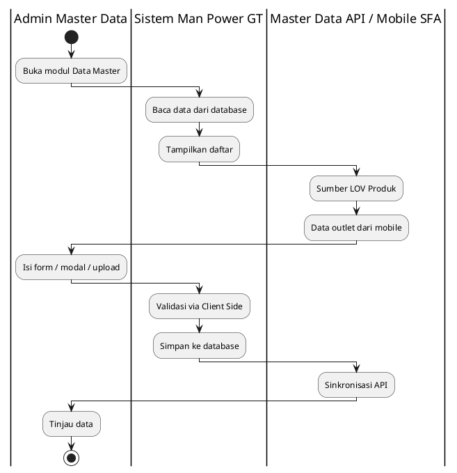
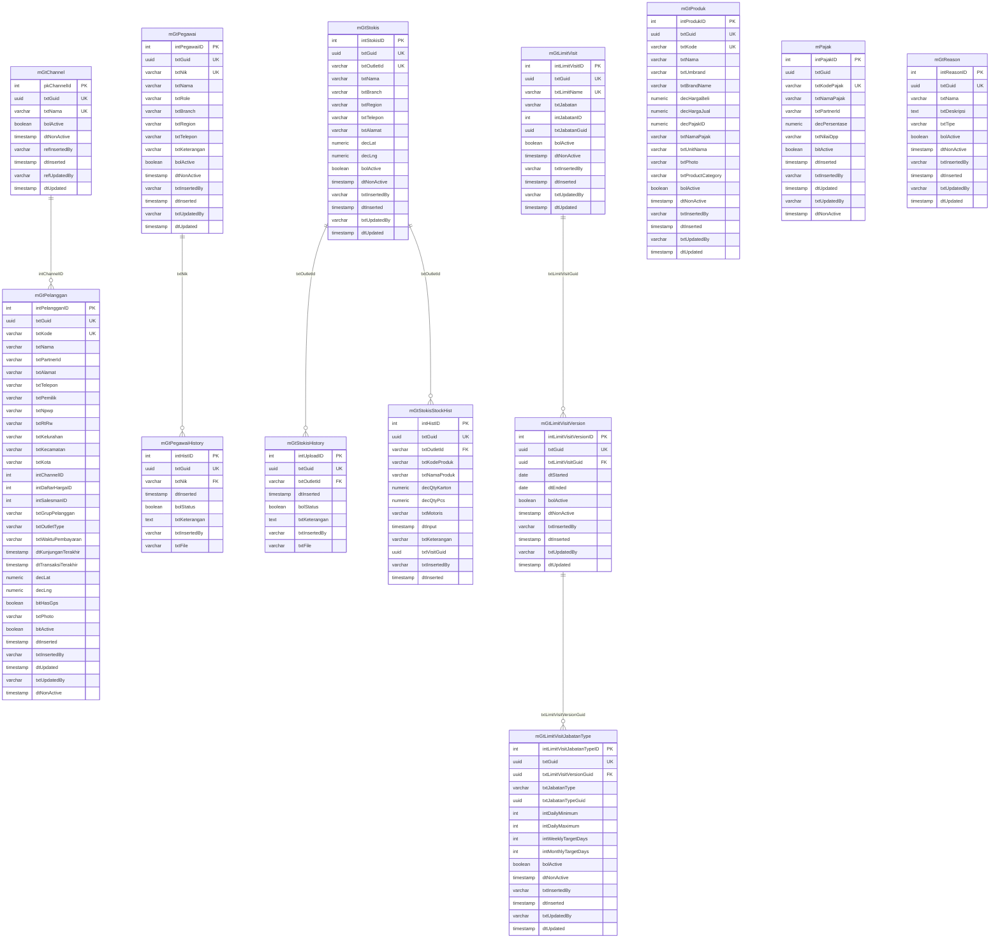

# FUNCTIONAL SPECIFICATION DOCUMENT (FSD)
## Modul: Man Power GT — Data Master (Web Admin)
### Sistem: Man Power GT
### Versi Dokumen: 2.0

---

| Atribut | Keterangan |
|---------|------------|
| **Nama Dokumen** | FSD Modul Data Master — Web Admin Man Power GT |
| **Versi** | 2.0 |
| **Tanggal** | 17 September 2026 |
| **Divisi** | IT / Business – Man Power GT |
| **Status** | Draft |
| **Dibuat oleh** | Tim IT – Man Power GT |

---

## Riwayat Revisi

| Versi | Tanggal | Diubah Oleh | Keterangan |
|---------|-------------|-------------|------------|
| **2.0** | **17 September 2026** | **Tim IT** | Tulis ulang: ERD/mapping dari MAVEN.DAL GT (`mGt*`, `mPajak`, `mGtReason`); screenshot di-capture ulang |
| 1.17 | 12 Agustus 2026 | Tim IT | FSD v1.17 (pipeline terpisah, tidak diubah) |

---

## Persetujuan Dokumen (Document Approval)

| Full Name | Job Title | Signature | Signature Date |
|-----------|-----------|-----------|----------------|
| Muhammad Rafi | SHP Channel & Customer Development |  |  |
| Silvester Mario Nian Destrada | SHP Channel & Customer Development |  |  |
| Aldira Rahmania | SHP Channel & Customer Development |  |  |
| Ageng Kurniawan Sugianto | IT Product |  |  |
| Albet | IT Product |  |  |

---

## 1. Pendahuluan

### 1.1 Latar Belakang

**Man Power GT** (*Man Power General Trade*) adalah sistem internal PT Kalbe
Nutritionals untuk mengelola tenaga lapangan General Trade (motoris / canvasser),
administrasi data master terkait, monitoring penjualan lapangan, dan pelacakan
kunjungan sales. Dokumen ini memfokuskan lingkup pada **modul Data Master** Web Admin
(`Views/FPRS/MasterData/` dan **Master Data Portal** `Views/MasterDataPortal/` untuk Channel).

Prototipe Web Portal berupa *high-fidelity interactive prototype* berbasis HTML
statis (MPA) bertema Vuexy/Bootstrap yang menggunakan **localStorage** dan file
JSON seed di `wwwroot/data/` sebagai lapisan persistensi sisi klien, sebelum
integrasi penuh ke Master Data API Kalbe dan backend MAVEN.

### 1.2 Tujuan Dokumen

1. Mendeskripsikan fungsionalitas **per halaman dan per komponen UI** modul Data Master.
2. Menjadi acuan pengembangan backend/API dan UAT untuk data referensi FPRS.
3. Mendokumentasikan business rules, pola CRUD, sumber data, integrasi API, RBAC, dan data layer.
4. Menyelaraskan skema data dengan **tabel MAVEN.DAL yang sudah ada** (bukan nama rencana lama).
5. Mengikuti standar **FSD Generator Engine** (Kalbe Nutritionals).

### 1.3 Ruang Lingkup

| Dalam lingkup | Di luar lingkup |
|---------------|-----------------|
| Delapan modul di `Views/FPRS/MasterData/` + portal Channel | Penjualan, Kunjungan, Dashboard |
| Produk, Pelanggan, Channel, Pegawai, Stokis, Limit, Pajak, Alasan | Mobile SFA (kecuali sebagai sumber data Pelanggan) |
| Persistensi prototipe (localStorage + JSON seed) | Mengubah skema MAVEN.DAL |
| Mapping UI → tabel/kolom DAL GT | Workflow approval multi-level |
| Target RBAC produksi (KNGlobal) | FSD v1.17 (tetap sebagai arsip) |

### 1.4 Stakeholder

| Peran | Tim/Divisi | Keterlibatan |
|-------|------------|--------------|
| Admin Master Data | IT / Operations | CRUD & sinkronisasi data referensi |
| Supervisor Sales | Sales | Validasi data outlet & pegawai (read) |
| Developer | IT | Implementasi API & UI produksi (MAVEN) |
| Business Analyst | PDV / Sales | Validasi alur bisnis & sumber data |
| IT Security / Access Admin | IT | Konfigurasi role access KNGlobal |

---

## 2. Arsitektur & Alur Data Master

### 2.1 Ringkasan Teknis

| Aspek | Prototipe | Produksi (MAVEN) |
|-------|-----------|------------------|
| Arsitektur | Static MPA — satu `.html` per halaman | ASP.NET Core MVC + service layer |
| UI Framework | Bootstrap 5.3, Vuexy Admin Theme | Vuexy + Razor Views |
| JavaScript | jQuery, DataTables, Select2, SweetAlert2 | Sama (server-side DataTable) |
| Persistensi | `localStorage` + seed `wwwroot/data/*.json` | PostgreSQL via `MavenContext` (EF Core) |
| Auth / Menu | Tidak ada login | KNGlobal SSO + `mMenu` / `mRoleAccess` |
| Navigasi | `wwwroot/js/layout.js` | Menu dinamis dari KNGlobal |
| Branding | Kalbe hijau `#005d41`, font Kalbe Geometric | Sama |

### 2.2 Pola Pengelolaan Data Master

| Pola | Modul | Cara Kelola | Tabel DAL |
|------|-------|-------------|-----------|
| Form (add/edit) | Produk | Halaman detail + LOV SKU + Param Category | `mGtProduk` (denormalisasi brand/pajak/unit) |
| Modal CRUD | Pajak, Alasan | Modal di Index | `mPajak`, `mGtReason` |
| Upload-only (CSV + history) | Pegawai, Stokis | Download/Upload CSV | `mGtPegawai` + `mGtPegawaiHistory`; `mGtStokis` + history |
| View-only (sumber mobile) | Pelanggan | List + detail read-only | `mGtPelanggan` |
| Dual-surface (Portal CRUD + MP GT view-only) | Channel | Portal Mapping/Manage; FPRS list | DAL: hanya `mGtChannel`. TypeCus/Account belum di DAL |
| Form + versi (append-only) | Limit | Header + versi + type jabatan | `mGtLimitVisit` → Version → JabatanType |

### 2.3 Business Flow (Swimlane)

Alur berikut menggambarkan pengelolaan Data Master **saat menggunakan database produksi** (MAVEN / PostgreSQL), bukan localStorage prototipe.

**Lane (urutan kiri → kanan):**

| # | Lane ID | Label | Tipe | Sumber |
|---|---------|-------|------|--------|
| 1 | L1 | Admin Master Data | User | RBAC Web Admin |
| 2 | L2 | Sistem Man Power GT | System | Controllers PowerGT Master Data |
| 3 | L3 | Master Data API / Mobile SFA | External | LOV Produk + sync outlet |

Hand-off Admin → Sistem: setiap operasi form/modal/upload dibaca dan disimpan ke database. Hand-off Sistem ↔ API/Mobile: LOV Produk dan data outlet mensuplai form; hasil simpan dapat disinkronkan ke API.

### 2.4 Ringkasan Alur per Pola (Produksi)

| Pola | Trigger | Validasi utama | Hasil | Approval |
|------|---------|----------------|-------|----------|
| Form Produk | Create / Edit | Kode dari LOV API; harga beli > 0; kode unik | Insert/update `mGtProduk` | Tidak ada |
| Modal Pajak/Alasan | Tambah / Ubah (/ Hapus) | Field wajib; unik nama/kode | Persist `mPajak` / `mGtReason` | Tidak ada |
| CSV Pegawai/Stokis | Upload file | Header dikenali; baris wajib; Stokis GPS unik | Upsert Active; absen di file → Inactive + hist | Tidak ada |
| Channel | Portal Mapping/Manage; FPRS view-only | Prototipe: TypeCus/Account/triple unik | Produksi v2: persist `mGtChannel` | Tidak ada |
| Pelanggan | Buka list/detail | — (read-only) | Tampil dari `mGtPelanggan` | N/A |
| Limit | Create header / append versi | Nama unik; Max≥Min; no backdate; overlap dialog | `mGtLimitVisit` + Version + JabatanType | Tidak ada |

**Catatan approval:** modul Data Master **tidak** memakai workflow approval multi-level.

### 2.5 Arsitektur Produksi MAVEN (Target)

Prototipe Falcon FPRS dikembangkan ke aplikasi produksi **MAVEN**
(ASP.NET Core MVC + EF Core + PostgreSQL).

| Layer MAVEN | Peran | Contoh (modul GT) |
|-------------|-------|-------------------|
| `MAVEN` (Web) | Controller + View Razor + JS DataTable | `Controllers/PowerGT/Master/*` |
| `MAVEN.Services` | Business logic | `MasterProductService`, `MasterStokisService` |
| `MAVEN.DAL` | DbContext + ModelBuilder | `MavenContext`, `MGtProdukModelBuilder` |
| `MAVEN.Common` | Entity + ViewModel | `Entity/GT/Master/MGtProduk.cs` |

**Konvensi tabel GT (yang dipakai dokumen ini):**

| Prefix | Tipe | Contoh |
|--------|------|--------|
| `mGtXxx` | Tabel master Man Power GT | `mGtProduk`, `mGtStokis` |
| `mPajak` | Lookup pajak (tabel lama, bukan `mGt*`) | `mPajak.txtKodePajak` |
| `int` / `pk` | PK integer | `intProdukID`, `pkChannelId` |
| `txt` | Teks / kode / GUID string | `txtKode`, `txtNik`, `txtOutletId` |
| `dec` | Numeric | `decHargaJual`, `decLat` |
| `bol` / `bit` | Boolean | `bolActive` (kebanyakan GT), `bitActive` (`mPajak`, `mGtPelanggan`) |
| `dt` | Timestamp / date | `dtInserted`, `dtStarted` |

**Blok audit:** `dtInserted`, `txtInsertedBy` / `refInsertedBy`, `dtUpdated`, `txtUpdatedBy` / `refUpdatedBy`, `dtNonActive`, plus flag aktif.

**Database:** PostgreSQL via `MavenContext` (`PostgreDBConnection`).

**Identitas publik API:** `txtGuid` (UUID). PK integer tidak diekspos ke luar.

---

## 3. Modul Data Master

Bab ini mendeskripsikan setiap modul Data Master: kolom dashboard list, field form/modal/detail, tombol aksi, business rules, dan pola CRUD. Konten field/kolom/validasi diambil dari file HTML sumber. Mapping database mengikuti MAVEN.DAL GT.

### 3.1 Produk

Modul **Produk** merupakan bagian dari Web Portal Falcon FPRS. Tipe UI: **page**.

Halaman dashboard list menampilkan **summary cards** (`cntTotal`, `cntActive`, `cntInactive`, `cntUmbrella`) dan DataTable `#tbl` dengan filter per kolom, termasuk kolom **Category**, **Umbrella Brand**, dan thumbnail **Foto**. Tombol **Tambah Produk** mengarah ke `detail.html`. Halaman `detail.html` bersifat fleksibel (add & edit): **Kode Produk** berupa LOV searchable (Select2) yang mengambil data dari Master Data API, mengunci field turunan (nama, umbrella, brand) menjadi read-only. **Product Category** dropdown wajib dari Master Data API `GET /api/v1/Param` dengan **`paramCode = PRODUCT_CATEGORY_GT`** (prototipe: seed `param-product-category-gt.json`; simpan `kategori`, `kategoriCode`, `kategoriId`). **Foto Produk** dapat di-upload (JPG/PNG/WebP, dikompres otomatis) dan disimpan pada field `foto`. **Harga Beli** dapat diedit, **Harga Jual** read-only dihitung otomatis (`Harga Beli + PPN`, default skema PPN 11%). **Unit Konversi** dikunci ke `PCS`, dan **Status Produk** berupa checkbox aktif/nonaktif.

| Aspek | Keterangan |
|-------|------------|
| **Tujuan Form** | Mendaftarkan dan memelihara data SKU/produk (kode, umbrella brand, brand, harga beli, harga jual, pajak, status, foto produk) sebagai referensi transaksi penjualan. Data produk bersumber dari Master Data API, sedangkan harga jual, pajak, status, dan foto dikelola di aplikasi ini. |
| **Pengguna** | Admin Master Data, IT Operations — pengelola katalog produk Kalbe. |

<!-- fig-title: Master Data — Produk — Dashboard List -->

#### 3.1.1 Kolom DataTable Dashboard List

| Kolom | Field Key | Render | Sortable | Keterangan |
|-------|-----------|--------|----------|------------|
| NO | `No` | Text | Ya | Kolom grid dashboard list |
| FOTO | `Foto` | Text | Ya | Kolom grid dashboard list |
| KODE | `Kode` | Text | Ya | *mProduk \| txtKode* |
| PRODUK | `Produk` | Text | Ya | *mProduk \| txtNama* |
| CATEGORY | `Category` | Text | Ya | *Master Data API /api/v1/Param \| paramCode=PRODUCT_CATEGORY_GT* |
| UMBRELLA BRAND | `UmbrellaBrand` | Text | Ya | *mProduk \| txtUmbrella* |
| BRAND | `Brand` | Text | Ya | *mProduk \| intBrandID (FK mBrand.BrandName)* |
| UNIT | `Unit` | Text | Ya | *mProduk \| intUnitID (FK mUnit.txtNama)* |
| HARGA JUAL | `HargaJual` | Text | Ya | *mProduk \| decHargaJual* |
| PAJAK | `Pajak` | Text | Ya | *mProduk \| intPajakID (FK mPajak.txtNamaPajak)* |
| STATUS | `Status` | Text | Ya | *mProduk \| bitActive* |

#### 3.1.2 Tombol Aksi — Dashboard List

| Tampilan | Tombol | ID / Handler | Warna/Style | Fungsi |
|----------|--------|--------------|-------------|--------|
|  | Tambah Produk | `—` | btn-success | Membuka modal form untuk menambah data baru. |
|  | Detail / Ubah | `—` | btn-outline-secondary | Menampilkan halaman detail record terpilih (parameter URL terenkripsi). |
|  | Hapus foto | `btnClearFoto` | btn-outline-secondary | Menghapus data terpilih setelah konfirmasi pengguna. |

<!-- fig-title: Master Data — Produk — Halaman Detail -->

#### 3.1.3 Form Tambah/Ubah

| Field Name | ID Elemen | Tipe | Mandatory | Default | Validasi | Keterangan |
|------------|-----------|------|-----------|---------|----------|------------|
| Kode Produk | `kode` | Dropdown | Ya | (kosong) | Wajib; Kode produk wajib dipilih dari Master Data API.; Data produk belum termuat. Pilih ulang Kode Produk.; Kode "{nilai}" sudah terdaftar pada Master Produk. | *mProduk \| txtKode* |
| Nama Produk | `nama` | Text (readonly) | Tidak | (kosong) | readonly | *mProduk \| txtNama* |
| Umbrella Brand | `umbrella` | Text (readonly) | Tidak | (kosong) | readonly | *mProduk \| txtUmbrella* |
| Brand | `brand` | Text (readonly) | Tidak | (kosong) | readonly | *mProduk \| intBrandID (FK mBrand)* |
| Product Category | `kategori` | Dropdown | Ya | (kosong) | Wajib; Product Category wajib dipilih. | *Master Data API /api/v1/Param \| paramCode=PRODUCT_CATEGORY_GT* |
| Harga Beli | `hargaBeli` | Number | Ya | (kosong) | Wajib; min=0; Harga beli harus lebih dari 0. | *mProduk \| decHargaBeli* |
| Skema Pajak | `namaPajak` | Dropdown | Ya | (kosong) | Wajib | *mProduk \| intPajakID (FK mPajak)* |
| Harga Jual (otomatis) | `hargaJual` | Number | Tidak | (kosong) | readonly | *mProduk \| decHargaJual* |
| Unit Konversi | `unitNama` | Text (readonly) | Tidak | PCS | readonly | *mProduk \| intUnitID (FK mUnit)* |
| Status Produk | `status` | Text | Tidak | (kosong) | — | *mProduk \| bitActive* |

#### 3.1.4 Tombol Aksi — Halaman Detail

| Tampilan | Tombol | ID / Handler | Warna/Style | Fungsi |
|----------|--------|--------------|-------------|--------|
|  | Simpan Produk | `—` | btn-success | Menyimpan perubahan dari modal ke penyimpanan lokal setelah validasi. |

#### 3.1.5 Business Rules

| Rule ID | Aturan |
|---------|--------|
| BR-MD01 | File harus berupa gambar. |
| BR-MD02 | Ukuran file maksimal 2 MB. |
| BR-MD03 | Kode produk wajib dipilih dari Master Data API. |
| BR-MD04 | Data produk belum termuat. Pilih ulang Kode Produk. |
| BR-MD05 | Harga beli harus lebih dari 0. |
| BR-MD06 | Product Category wajib dipilih. |
| BR-MD07 | Kode "${kode}" sudah terdaftar pada Master Produk. |

#### 3.1.6 CRUD

| Operasi | Cara | Role | Keterangan |
|---------|------|------|------------|
| **Create** | Klik Tambah Produk → `detail.html` (LOV Kode Produk + upload Foto) | Admin | Simpan setelah validasi |
| **Read** | dashboard list (DataTable + thumbnail foto) + `detail.html` | Semua role | — |
| **Update** | Buka `detail.html?param=` → ubah harga beli/pajak/status/foto | Admin | Kode & data API read-only |

#### 3.1.6 Mapping Database MAVEN (`mGtProduk`)

Tabel `mGtProduk` **denormalisasi**: nama brand, pajak, dan unit disimpan sebagai kolom teks/angka, bukan foreign key.

| Field UI / Kolom Grid | Tabel | Kolom | Kunci | Keterangan |
|-----------------------|-------|-------|-------|------------|
| Kode Produk | `mGtProduk` | `txtKode` | UK | LOV dari Master Data API |
| Nama Produk | `mGtProduk` | `txtNama` | | Read-only dari API |
| Umbrella Brand | `mGtProduk` | `txtUmbrand` | | Teks, bukan FK `mGtBrand` |
| Brand | `mGtProduk` | `txtBrandName` | | Teks denormalisasi |
| Product Category | `mGtProduk` | `txtProductCategory` | | LOV Param `PRODUCT_CATEGORY_GT` |
| Foto Produk | `mGtProduk` | `txtPhoto` | | Path relatif wwwroot |
| Harga Beli | `mGtProduk` | `decHargaBeli` | | ≥ 0 |
| Harga Jual | `mGtProduk` | `decHargaJual` | | Kalkulasi dari harga beli + persen pajak |
| Tarif pajak (%) | `mGtProduk` | `decPajakID` | | Numeric persen (contoh 11), **bukan** FK ke `mPajak` |
| Nama Pajak | `mGtProduk` | `txtNamaPajak` | | Teks denormalisasi |
| Unit | `mGtProduk` | `txtUnitNama` | | Teks (prototipe: PCS) |
| Status | `mGtProduk` | `bolActive` | | |

> `mGtBrand` dan `mGtUnit` ada di DAL tetapi **tidak** direlasikan ke `mGtProduk` dan tidak punya halaman di `Views/FPRS/MasterData`.

### 3.2 Pelanggan

Modul **Pelanggan** merupakan bagian dari Web Portal Falcon FPRS. Tipe UI: **page**.

Data pelanggan/outlet **diinput dari aplikasi mobile** (SFA), sehingga Web Portal bersifat **view-only** — tanpa tombol Tambah/Edit/Hapus. Halaman detail menampilkan atribut hasil capture lapangan: foto outlet, pemilik, NPWP, alamat, RT/RW, kelurahan, kecamatan, kota, koordinat GPS, **channel**, dan tipe outlet. Data disimpan di `md_pelanggan`.

| Aspek | Keterangan |
|-------|------------|
| **Tujuan Form** | Menampilkan data outlet/pelanggan yang diinput dari aplikasi mobile (foto, pemilik, alamat, GPS, channel, tipe outlet) sebagai entitas utama kunjungan sales dan faktur. Bersifat view-only di web. |
| **Pengguna** | Admin Master Data, Operations, Supervisor Sales (validasi data outlet). |

<!-- fig-title: Master Data — Pelanggan — Dashboard List -->

#### 3.2.1 Kolom DataTable Dashboard List

| Kolom | Field Key | Render | Sortable | Keterangan |
|-------|-----------|--------|----------|------------|
| NO | `No` | Text | Ya | Kolom grid dashboard list |
| KODE | `Kode` | Text | Ya | *mPelanggan \| txtKode* |
| PELANGGAN | `Pelanggan` | Text | Ya | *mPelanggan \| txtNama* |
| ALAMAT | `Alamat` | Text | Ya | *mPelanggan \| txtAlamat* |
| TELEPON | `Telepon` | Text | Ya | *mPelanggan \| txtTelepon* |
| SALESMAN | `Salesman` | Text | Ya | *mPelanggan \| intSalesmanID (FK mPegawai)* |
| KUNJUNGAN TERAKHIR | `KunjunganTerakhir` | Text | Ya | *mPelanggan \| dtKunjunganTerakhir* |
| STATUS | `Status` | Text | Ya | *mPelanggan \| bitActive* |

#### 3.2.2 Tombol Aksi — Dashboard List

| Tampilan | Tombol | ID / Handler | Warna/Style | Fungsi |
|----------|--------|--------------|-------------|--------|
|  | Detail | `—` | btn-outline-secondary | Menampilkan halaman detail record terpilih (parameter URL terenkripsi). |

<!-- fig-title: Master Data — Pelanggan — Halaman Detail -->

#### 3.2.3 Tombol Aksi — Halaman Detail

| Tampilan | Tombol | ID / Handler | Warna/Style | Fungsi |
|----------|--------|--------------|-------------|--------|
|  | Kembali | `—` | btn-secondary | Kembali ke dashboard list modul. |

#### 3.2.4 CRUD

| Operasi | Cara | Role | Keterangan |
|---------|------|------|------------|
| **Create** | — | — | Data diinput dari aplikasi mobile (SFA) |
| **Read** | dashboard list (DataTable) + `detail.html` | Semua role | View-only |

#### 3.2.6 Mapping Database MAVEN (`mGtPelanggan`)

| Field UI / Kolom Grid | Tabel | Kolom | Kunci | Keterangan |
|-----------------------|-------|-------|-------|------------|
| Kode | `mGtPelanggan` | `txtKode` | UK | |
| Nama | `mGtPelanggan` | `txtNama` | | |
| Partner ID | `mGtPelanggan` | `txtPartnerId` | | |
| Alamat | `mGtPelanggan` | `txtAlamat` | | |
| Telepon | `mGtPelanggan` | `txtTelepon` | | |
| Pemilik | `mGtPelanggan` | `txtPemilik` | | Dari mobile |
| NPWP | `mGtPelanggan` | `txtNpwp` | | |
| RT/RW, Kelurahan, Kecamatan, Kota | `mGtPelanggan` | `txtRtRw`, `txtKelurahan`, `txtKecamatan`, `txtKota` | | |
| Channel | `mGtPelanggan` | `intChannelID` | lookup | Navigasi EF ke `mGtChannel`; **tidak ada constraint FK di DB** |
| Daftar Harga | `mGtPelanggan` | `intDaftarHargaID` | | Tanpa FK di ModelBuilder |
| Salesman | `mGtPelanggan` | `intSalesmanID` | | Tanpa FK ke `mGtPegawai` |
| Grup / Tipe Outlet | `mGtPelanggan` | `txtGrupPelanggan`, `txtOutletType` | | |
| Waktu Pembayaran | `mGtPelanggan` | `txtWaktuPembayaran` | | |
| Kunjungan / Transaksi terakhir | `mGtPelanggan` | `dtKunjunganTerakhir`, `dtTransaksiTerakhir` | | |
| GPS | `mGtPelanggan` | `decLat`, `decLng`, `bitHasGps` | | |
| Foto Toko | `mGtPelanggan` | `txtPhoto` | | |
| Status | `mGtPelanggan` | `bitActive` | | Bukan `bolActive` |

### 3.3 Channel

Modul **Channel** mengatur klasifikasi outlet lewat **mapping triple**: **Channel** · **Type Customer** · **Account** (kombinasi unik).

Prototipe memakai **dual-surface**:

- **Master Data Portal** — kelola master dan mapping (tab **Mapping** + **Manage**).
- **Man Power GT** — lihat daftar mapping saja; tanpa tambah, ubah, atau hapus.

**Type Customer** adalah master **global** (bukan turunan Channel). Hubungan ke Channel hanya lewat baris mapping.

| Aspek | Keterangan |
|-------|------------|
| **Tujuan Form** | Mengelola master Channel, Type Customer (global), Account, dan mapping triple di **Master Data Portal** (tab Mapping + Manage); menu Channel Man Power GT hanya list mapping view-only. |
| **Pengguna** | Admin Master Data (CRUD Portal); Sales Ops / Supervisor (view FPRS). |

<!-- fig-title: Master Data — Channel — Master Data Portal — Tab Mapping -->

<!-- fig-title: Master Data — Channel — Master Data Portal — Tab Manage -->

<!-- fig-title: Master Data — Channel — Man Power GT — View-only List -->

<!-- fig-title: Master Data — Channel — Modal Tambah Mapping -->

<!-- fig-title: Master Data — Channel — Modal Tambah Channel -->

<!-- fig-title: Master Data — Channel — Modal Tambah Type Customer -->

<!-- fig-title: Master Data — Channel — Modal Tambah Account -->

#### 3.3.1 Kolom DataTable Dashboard List

| Kolom | Field Key | Render | Sortable | Keterangan |
|-------|-----------|--------|----------|------------|
| NO | `No` | Text | Ya | Kolom grid dashboard list |
| CHANNEL | `Channel` | Text | Ya | Kolom grid dashboard list |
| TYPE CUSTOMER | `TypeCustomer` | Text | Ya | Kolom grid dashboard list |
| ACCOUNT | `Account` | Text | Ya | Kolom grid dashboard list |

#### 3.3.2 Tombol Aksi — Mapping & Manage

| Tampilan | Tombol | ID / Handler | Warna/Style | Fungsi |
|----------|--------|--------------|-------------|--------|
|  | Tambah Mapping | `btnAddMapping` | btn-success | Membuka modal untuk menambah triple mapping baru. |
|  | Hapus | `btn-del-map` | btn-outline-danger | Menghapus baris mapping setelah konfirmasi. |
|  | Mapping | `tab-mapping-btn` | btn-secondary | Menampilkan tab daftar triple mapping. |
|  | Manage | `tab-manage-btn` | btn-secondary | Menampilkan tab kelola master Channel, Type Customer, dan Account. |
|  | Channel | `hdChannel` | btn-secondary | Membuka panel master Channel pada tab Manage. |
|  | Tambah Channel | `btnAddChannel` | btn-success | Membuka modal tambah master Channel. |
|  | Ubah Channel | `btn-edit-ch` | btn-outline-success | Membuka modal ubah master Channel terpilih. |
|  | Simpan Channel | `btnSaveChannel` | btn-success | Menyimpan master Channel setelah validasi. |
|  | Type Customer | `hdTypeCus` | btn-secondary | Membuka panel master Type Customer (global). |
|  | Tambah Type Customer | `btnAddTypeCus` | btn-success | Membuka modal tambah Type Customer. |
|  | Ubah Type Customer | `btn-edit-tc` | btn-outline-success | Membuka modal ubah Type Customer terpilih. |
|  | Simpan Type Customer | `btnSaveTypeCus` | btn-success | Menyimpan master Type Customer setelah validasi. |
|  | Account | `hdAccount` | btn-secondary | Membuka panel master Account (global). |
|  | Tambah Account | `btnAddAccount` | btn-success | Membuka modal tambah Account. |
|  | Ubah Account | `btn-edit-acc` | btn-outline-success | Membuka modal ubah Account terpilih. |
|  | Simpan Account | `btnSaveAccount` | btn-success | Menyimpan master Account setelah validasi. |
|  | Simpan Mapping | `btnSaveMapping` | btn-success | Menyimpan triple mapping setelah validasi. |
| — | Simpan | `btnSaveChannel` | btn-success | Menyimpan perubahan dari modal ke penyimpanan lokal setelah validasi. |

#### 3.3.3 Business Rules

| Rule ID | Aturan |
|---------|--------|
| BR-MD08 | Nama Channel wajib diisi. |
| BR-MD09 | Nama Channel sudah dipakai. |
| BR-MD10 | Nama Type Customer wajib diisi. |
| BR-MD11 | Nama Type Customer sudah dipakai. |
| BR-MD12 | Kode Account wajib diisi. |
| BR-MD13 | Kode Account sudah dipakai. |
| BR-MD14 | Belum ada Channel aktif. Tambah di tab Manage. |
| BR-MD15 | Belum ada Type Customer aktif. Tambah di tab Manage. |
| BR-MD16 | Belum ada Account aktif. Tambah di tab Manage. |
| BR-MD17 | Channel, Type Customer, dan Account wajib dipilih. |
| BR-MD18 | Mapping triple sudah ada. |

#### 3.3.4 CRUD

| Operasi | Cara | Role | Keterangan |
|---------|------|------|------------|
| **Create** | Portal: Tambah Mapping / Channel / Type Customer / Account (tab Manage) | Admin Master Data | TypeCus & Account global; FPRS tidak punya Create |
| **Read** | Portal Mapping+Manage; FPRS list mapping view-only (tanpa detail) | Semua role dengan bitView | Data sama di kedua surface |
| **Update** | Hanya di Master Data Portal (tab Manage / Mapping) | Admin Master Data | TypeCus unik global; Account unik global; triple unik |
| **Delete** | Portal: hapus baris Mapping; soft nonaktif master via Status | Admin Master Data | FPRS tidak bisa hapus/ubah |

#### 3.3.6 Mapping Database MAVEN (`mGtChannel`)

| Field UI / Kolom Grid | Tabel | Kolom | Kunci | Keterangan |
|-----------------------|-------|-------|-------|------------|
| Nama Channel | `mGtChannel` | `txtNama` | UK | Master global |
| Status | `mGtChannel` | `bolActive` | | |
| PK | `mGtChannel` | `pkChannelId` | PK | Kolom fisik `pkChannelId` |
| GUID | `mGtChannel` | `txtGuid` | UK | Identitas API |

> **Belum ada di MAVEN.DAL:** tabel Type Customer, Account, dan mapping triple. UI portal (tab Mapping / Manage) adalah perilaku prototipe. Jangan menggambar entity fiktif di ERD.

#### 3.3.5 Narasi Validasi (Master Data Portal)

Validasi di modul **Channel** ditampilkan sebagai dialog **SweetAlert** saat simpan master atau mapping gagal. Di prototipe, Type Customer dan Account bersifat master global; triple Channel · Type Customer · Account harus unik.

> **MAVEN.DAL saat ini** hanya punya `mGtChannel`. Type Customer / Account / mapping **belum** ada di DAL — jangan dianggap sudah terbit di produksi.

**Validasi master (modal Channel / Type Customer / Account):**

| Rule ID | Kondisi | Tampilan |
|---------|---------|----------|
| BR-MD08 | Nama Channel kosong |  |
| BR-MD09 | Nama Channel sudah dipakai |  |
| BR-MD10 | Nama Type Customer kosong |  |
| BR-MD11 | Nama Type Customer sudah dipakai |  |
| BR-MD12 | Kode Account kosong |  |
| BR-MD13 | Kode Account sudah dipakai |  |

**Validasi mapping (tab Mapping):**

| Rule ID | Kondisi | Tampilan |
|---------|---------|----------|
| BR-MD14 | Belum ada Channel aktif |  |
| BR-MD15 | Belum ada Type Customer aktif |  |
| BR-MD16 | Belum ada Account aktif |  |
| BR-MD17 | Channel / Type Customer / Account belum dipilih |  |
| BR-MD18 | Triple mapping sudah ada |  |

### 3.4 Pegawai

Modul **Pegawai** merupakan bagian dari Web Portal Falcon FPRS. Tipe UI: **page**.

Master pegawai/sales force bersifat **upload-only** (pola seperti Master Stokis): data disinkronkan via **Download/Upload CSV** dan setiap perubahan status Active/Inactive dicatat pada **riwayat status**. Setiap pegawai memiliki **role** (Motoris / SPG GT) dan penempatan **Branch** & **Region**. Identitas unik menggunakan **NIK**. Halaman `detail.html` menampilkan data pegawai secara read-only beserta riwayat status.

| Aspek | Keterangan |
|-------|------------|
| **Tujuan Form** | Memelihara data pegawai/sales force (Motoris, SPG GT) beserta NIK, Branch, dan Region melalui mekanisme Download/Upload CSV dengan pencatatan riwayat status aktif/nonaktif. |
| **Pengguna** | Admin HR, IT, Supervisor Sales. |

<!-- fig-title: Master Data — Pegawai — Dashboard List -->

#### 3.4.1 Kolom DataTable Dashboard List

| Kolom | Field Key | Render | Sortable | Keterangan |
|-------|-----------|--------|----------|------------|
| NO | `No` | Text | Ya | Kolom grid dashboard list |
| NIK | `Nik` | Text | Ya | *mPegawai \| txtKode (NIK)* |
| NAMA | `Nama` | Text | Ya | *mPegawai \| txtNama* |
| ROLE | `Role` | Text | Ya | *mPegawai \| txtRole* |
| BRANCH | `Branch` | Text | Ya | *mPegawai \| txtBranch* |
| REGION | `Region` | Text | Ya | *mPegawai \| txtRegion* |
| STATUS | `Status` | Text | Ya | *mPegawai \| bitActive* |

#### 3.4.2 Tombol Aksi — Dashboard List

| Tampilan | Tombol | ID / Handler | Warna/Style | Fungsi |
|----------|--------|--------------|-------------|--------|
|  | Download Data | `downloadPegawai()` | btn-outline-secondary | Mengunduh data modul sebagai file CSV. |
|  | Upload Data | `triggerUploadPegawai()` | btn-outline-secondary | Mengunggah file CSV untuk sinkronisasi data. |
|  | Lihat Detail | `—` | btn-outline-secondary | Menampilkan halaman detail record terpilih (parameter URL terenkripsi). |

<!-- fig-title: Master Data — Pegawai — Halaman Detail -->

#### 3.4.3 Form Detail (read-only)

| Field Name | ID Elemen | Tipe | Mandatory | Default | Validasi | Keterangan |
|------------|-----------|------|-----------|---------|----------|------------|
| NIK | `kode` | Text | Tidak | (kosong) | readonly | *mPegawai \| txtKode (NIK)* |
| Nama | `nama` | Text | Tidak | (kosong) | readonly | *mPegawai \| txtNama* |
| Role | `role` | Text | Tidak | (kosong) | readonly | *mPegawai \| txtRole* |
| Branch | `branch` | Text | Tidak | (kosong) | readonly | *mPegawai \| txtBranch* |
| Region | `region` | Text | Tidak | (kosong) | readonly | *mPegawai \| txtRegion* |
| Telepon | `telepon` | Text | Tidak | (kosong) | readonly | *mPegawai \| txtTelepon* |
| Status | `status` | Text | Tidak | (kosong) | readonly | *mPegawai \| bitActive* |
| Keterangan | `keterangan` | Text | Tidak | (kosong) | readonly | *mPegawai \| txtKeterangan* |

#### 3.4.4 Tombol Aksi — Halaman Detail

| Tampilan | Tombol | ID / Handler | Warna/Style | Fungsi |
|----------|--------|--------------|-------------|--------|
|  | Kembali | `—` | btn-secondary | Kembali ke dashboard list modul. |

#### 3.4.5 Business Rules

| Rule ID | Aturan |
|---------|--------|
| BR-MD19 | File kosong atau format header tidak dikenali. |
| BR-MD20 | Tidak ada baris data yang dapat diproses. |

#### 3.4.6 CRUD

| Operasi | Cara | Role | Keterangan |
|---------|------|------|------------|
| **Create** | Upload CSV (baris baru) | Admin | Sinkronisasi dari file, bukan input manual |
| **Read** | dashboard list (DataTable) + `detail.html` | Semua role | Termasuk riwayat status/stok |
| **Update** | Upload CSV (status Active/Inactive) | Admin | Status disimpulkan dari keberadaan ID di file |

#### 3.4.6 Mapping Database MAVEN (`mGtPegawai`)

| Field UI / Kolom Grid | Tabel | Kolom | Kunci | Keterangan |
|-----------------------|-------|-------|-------|------------|
| NIK | `mGtPegawai` | `txtNik` | UK | Identitas CSV (bukan `txtKode`) |
| Nama | `mGtPegawai` | `txtNama` | | |
| Role | `mGtPegawai` | `txtRole` | | Motoris / SPG GT |
| Branch / Region | `mGtPegawai` | `txtBranch`, `txtRegion` | | |
| Telepon | `mGtPegawai` | `txtTelepon` | | |
| Keterangan | `mGtPegawai` | `txtKeterangan` | | |
| Status | `mGtPegawai` | `bolActive` | | Active/Inactive via CSV |
| Riwayat CSV | `mGtPegawaiHistory` | `txtNik`, `bolStatus`, `txtFile` | FK `txtNik` | Jejak upload |

### 3.5 Stokis

Modul **Stokis** merupakan bagian dari Web Portal Falcon FPRS. Tipe UI: **page**.

Master **Stokis/Grosir** bersifat **upload-only** (Download/Upload CSV + riwayat stok). Menampilkan **Branch** dan **Region** (menggantikan kolom Kota), koordinat GPS untuk validasi check-in mobile, serta island **Riwayat Input Stok oleh Motoris** pada halaman detail.

| Aspek | Keterangan |
|-------|------------|
| **Tujuan Form** | Mendaftarkan grosir/distributor stokis tempat salesman melakukan kulakan dan cek stok barang. Termasuk koordinat GPS untuk validasi check-in mobile. |
| **Pengguna** | Admin Master Data, Sales Operations, Supervisor Sales. |

<!-- fig-title: Master Data — Stokis — Dashboard List -->

#### 3.5.1 Kolom DataTable Dashboard List

| Kolom | Field Key | Render | Sortable | Keterangan |
|-------|-----------|--------|----------|------------|
| NO | `No` | Text | Ya | Kolom grid dashboard list |
| OUTLET ID | `OutletId` | Text | Ya | *mStokis \| txtOutletId* |
| NAMA STOKIS | `NamaStokis` | Text | Ya | *mStokis \| txtNama* |
| BRANCH | `Branch` | Text | Ya | *mStokis \| txtBranch* |
| REGION | `Region` | Text | Ya | *mStokis \| txtRegion* |
| STATUS | `Status` | Text | Ya | *mStokis \| bitActive* |

#### 3.5.2 Tombol Aksi — Dashboard List

| Tampilan | Tombol | ID / Handler | Warna/Style | Fungsi |
|----------|--------|--------------|-------------|--------|
|  | Download Data | `downloadStokis()` | btn-outline-secondary | Mengunduh data modul sebagai file CSV. |
|  | Upload Data | `triggerUploadStokis()` | btn-outline-secondary | Mengunggah file CSV untuk sinkronisasi data. |
|  | Lihat Detail | `—` | btn-outline-secondary | Menampilkan halaman detail record terpilih (parameter URL terenkripsi). |

<!-- fig-title: Master Data — Stokis — Halaman Detail -->

#### 3.5.3 Form Detail (read-only)

| Field Name | ID Elemen | Tipe | Mandatory | Default | Validasi | Keterangan |
|------------|-----------|------|-----------|---------|----------|------------|
| Outlet ID | `kode` | Text | Tidak | (kosong) | readonly | *mStokis \| txtOutletId* |
| Nama Stokis | `nama` | Text | Tidak | (kosong) | readonly | *mStokis \| txtNama* |
| Branch | `branch` | Text | Tidak | (kosong) | readonly | *mStokis \| txtBranch* |
| Region | `region` | Text | Tidak | (kosong) | readonly | *mStokis \| txtRegion* |
| Telepon | `telepon` | Text | Tidak | (kosong) | readonly | *mStokis \| txtTelepon* |
| Status | `status` | Text | Tidak | (kosong) | readonly | *mStokis \| bitActive* |
| Alamat Lengkap | `alamat` | Text | Tidak | (kosong) | readonly | *mStokis \| txtAlamat* |
| Latitude | `lat` | Text | Tidak | (kosong) | readonly | *mStokis \| decLat* |
| Longitude | `lng` | Text | Tidak | (kosong) | readonly | *mStokis \| decLng* |

#### 3.5.4 Tombol Aksi — Halaman Detail

| Tampilan | Tombol | ID / Handler | Warna/Style | Fungsi |
|----------|--------|--------------|-------------|--------|
|  | Kembali | `—` | btn-secondary | Kembali ke dashboard list modul. |
|  | Stok per Produk | `—` | btn-secondary | Membuka panel Stok per Produk menampilkan data terkait pada halaman detail. |
|  | Riwayat Input Stok oleh Motoris | `—` | btn-secondary | Membuka panel Riwayat Input Stok oleh Motoris menampilkan data terkait pada halaman detail. |
|  | Riwayat Status (Active / Inactive) — dari Upload | `—` | btn-secondary | Membuka panel Riwayat Status (Active / Inactive) — dari Upload menampilkan data terkait pada halaman detail. |

#### 3.5.5 Business Rules

| Rule ID | Aturan |
|---------|--------|
| BR-MD21 | File kosong atau format header tidak dikenali. |
| BR-MD22 | Tidak ada baris data yang dapat diproses. |

#### 3.5.6 CRUD

| Operasi | Cara | Role | Keterangan |
|---------|------|------|------------|
| **Create** | Upload CSV (baris baru) | Admin | Sinkronisasi dari file, bukan input manual |
| **Read** | dashboard list (DataTable) + `detail.html` | Semua role | Termasuk riwayat status/stok |
| **Update** | Upload CSV (status Active/Inactive) | Admin | Status disimpulkan dari keberadaan ID di file |

#### 3.5.6 Mapping Database MAVEN (`mGtStokis`)

| Field UI / Kolom Grid | Tabel | Kolom | Kunci | Keterangan |
|-----------------------|-------|-------|-------|------------|
| Outlet ID | `mGtStokis` | `txtOutletId` | UK | Identitas CSV |
| Nama | `mGtStokis` | `txtNama` | | |
| Branch / Region | `mGtStokis` | `txtBranch`, `txtRegion` | | |
| Telepon / Alamat | `mGtStokis` | `txtTelepon`, `txtAlamat` | | |
| GPS | `mGtStokis` | `decLat`, `decLng` | | Unik antar outlet di aturan UI |
| Status | `mGtStokis` | `bolActive` | | Active/Inactive via CSV |
| Riwayat upload | `mGtStokisHistory` | `txtOutletId`, `bolStatus`, `txtFile` | FK `txtOutletId` | |
| Riwayat stok | `mGtStokisStockHist` | `txtOutletId`, `txtKodeProduk`, `decQtyKarton`, `decQtyPcs` | FK `txtOutletId` | `txtKodeProduk` tanpa FK ke `mGtProduk` |

### 3.6 Limit

Modul **Limit** merupakan bagian dari Web Portal Falcon FPRS. Tipe UI: **page**.

<!-- fig-title: Master Data — Limit — Dashboard List -->

#### 3.6.1 Kolom DataTable Dashboard List

| Kolom | Field Key | Render | Sortable | Keterangan |
|-------|-----------|--------|----------|------------|
| NAMA | `Nama` | Text | Ya | Kolom grid dashboard list |
| JABATAN | `Jabatan` | Text | Ya | *Master Data API /api/v1/Position \| mJabatan.txtJabatanName → mLimitTargetHarian.txtJabatan* |
| TYPE JABATAN | `TypeJabatan` | Text | Ya | *Master Data API /api/v1/Position \| tipe jabatan → mLimitTargetHarian.txtTypeJabatan* |
| MIN HARIAN | `MinHarian` | Text | Ya | *mLimitTargetHarianVer \| intMinimalHarian* |
| MAX HARIAN | `MaxHarian` | Text | Ya | *mLimitTargetHarianVer \| intMaximalHarian* |
| ACTIVE | `Active` | Text | Ya | *mLimitTargetHarianVer \| bitActive (versi berlaku hari ini)* |

#### 3.6.2 Tombol Aksi — Dashboard List

| Tampilan | Tombol | ID / Handler | Warna/Style | Fungsi |
|----------|--------|--------------|-------------|--------|
|  | Create | `—` | btn-success | Menjalankan aksi Create. |
|  | Detail | `—` | btn-success | Menampilkan halaman detail record terpilih (parameter URL terenkripsi). |
|  | History | `—` | btn-secondary | Menjalankan aksi History. |
|  | Update | `btnUpdate` | btn-success | Menjalankan aksi terkait tombol Update. |
|  | Back | `—` | btn-danger | Menjalankan aksi Back. |

<!-- fig-title: Master Data — Limit — Halaman Detail -->

#### 3.6.3 Form Tambah/Ubah

| Field Name | ID Elemen | Tipe | Mandatory | Default | Validasi | Keterangan |
|------------|-----------|------|-----------|---------|----------|------------|
| Nama | `inputNama` | Text | Ya | (kosong) | Wajib; maks. 150 karakter | — |
| Jabatan | `inputJabatan` | Dropdown | Ya | (kosong) | Wajib | *Master Data API /api/v1/Position \| mJabatan.txtJabatanName* |
| Type Jabatan | `inputTypeJabatan` | Dropdown | Ya | (kosong) | Wajib | *Master Data API /api/v1/Position \| tipe jabatan (mTipeJabatan / intTipeJabatanId)* |
| Minimal Harian | `inputMin` | Number | Ya | (kosong) | Wajib; min=0 | — |
| Maximal Harian | `inputMax` | Number | Ya | (kosong) | Wajib; min=0 | — |
| Target HKE Mingguan | `inputHke` | Number | Ya | (kosong) | Wajib; min=0 | — |
| Target HKE Bulanan | `inputHkeBulanan` | Number | Ya | (kosong) | Wajib; min=0 | — |
| Tanggal Mulai | `inputMulai` | Text | Ya | (kosong) | Wajib | — |
| Tanggal Selesai | `inputSelesai` | Text | Ya | (kosong) | Wajib | — |

#### 3.6.4 Business Rules

| Rule ID | Aturan |
|---------|--------|
| BR-MD23 | ID limit tidak ditemukan. |
| BR-MD24 | Data limit tidak ditemukan. |
| BR-MD25 | Menutup versi aktif akan membuat periode versi lama tidak valid. Geser tanggal mulai versi baru saja. |
| BR-MD26 | Nama Limit wajib diisi. |
| BR-MD27 | Jabatan dan Type Jabatan wajib diisi. |
| BR-MD28 | Semua field angka dan periode wajib diisi (≥0). |
| BR-MD29 | Maximal Harian tidak boleh lebih kecil dari Minimal Harian. |
| BR-MD30 | Tanggal mulai tidak boleh backdate. Minimal hari ini. |
| BR-MD31 | Tanggal selesai tidak boleh sebelum tanggal mulai. |
| BR-MD32 | Nama Limit sudah dipakai (unik global). |
| BR-MD33 | Limit untuk pasangan Jabatan / Type Jabatan sudah ada (duplikat header). |
| BR-MD34 | Tidak ada slot tanggal mulai ≥ hari ini tanpa menutup versi aktif lebih awal. |
| BR-MD35 | Tanggal mulai yang digeser melebihi tanggal selesai. Perpanjang tanggal selesai dulu. |
| BR-MD36 | Setelah digeser masih bentrok. Tutup versi aktif lebih awal. |
| BR-MD37 | Periode bentrok: tanggal mulai versi baru bentrok dengan versi aktif — pilih Tutup versi aktif lebih awal / Geser mulai versi baru / Batal. |

#### 3.6.5 CRUD

| Operasi | Cara | Role | Keterangan |
|---------|------|------|------------|
| **Create** | Klik Tambah → `add.html` | Admin | — |
| **Read** | dashboard list + `detail.html` | Semua role | — |
| **Update** | Edit via `add.html?id=` | Admin | — |
| **Delete** | Konfirmasi Swal pada dashboard list | Admin | — |

#### 3.6.6 Mapping Database MAVEN (`mGtLimitVisit`)

Tiga tingkat: header → versi periode → angka per type jabatan.

| Field UI | Tabel | Kolom | Kunci | Keterangan |
|----------|-------|-------|-------|------------|
| Nama Limit | `mGtLimitVisit` | `txtLimitName` | UK | Unik global |
| Jabatan | `mGtLimitVisit` | `txtJabatan`, `intJabatanID`, `txtJabatanGuid` | | Snapshot + id/guid Position API |
| Status header | `mGtLimitVisit` | `bolActive` | | |
| Periode mulai / selesai | `mGtLimitVisitVersion` | `dtStarted`, `dtEnded` | | Tipe `date` |
| Versi aktif | `mGtLimitVisitVersion` | `bolActive` | | FK `txtLimitVisitGuid` → header `txtGuid` |
| Type Jabatan | `mGtLimitVisitJabatanType` | `txtJabatanType`, `txtJabatanTypeGuid` | UK per versi | |
| Minimal / Maximal harian | `mGtLimitVisitJabatanType` | `intDailyMinimum`, `intDailyMaximum` | | Bukan di header |
| Target HKE minggu / bulan | `mGtLimitVisitJabatanType` | `intWeeklyTargetDays`, `intMonthlyTargetDays` | | |

#### 3.6.7 Sumber Data Jabatan & Type Jabatan (Master Data API)

Pada halaman **Create / Detail** (form Header), dropdown **Jabatan** dan **Type Jabatan** bersumber dari **Master Data API** endpoint **`/api/v1/Position`**.

| Field UI | Sumber API (rencana produksi) | Persistensi DAL |
|----------|-------------------------------|-----------------|
| Nama | Input lokal (wajib, unik global) | `mGtLimitVisit.txtLimitName` |
| Jabatan | `/api/v1/Position` → nama jabatan | `mGtLimitVisit.txtJabatan` + `intJabatanID` + `txtJabatanGuid` |
| Type Jabatan | Tipe jabatan terkait Position | `mGtLimitVisitJabatanType.txtJabatanType` (+ guid) |

**UI prototipe:** banner info + tooltip `Source : Master Data API /api/v1/Position`. Produksi wajib LOV live.

#### 3.6.8 Narasi Validasi & Alur Versi

Modul **Limit** mengelola target kunjungan harian. Create membuat header + versi pertama; **Update selalu append versi baru** ke `mGtLimitVisitVersion` (lalu baris type di `mGtLimitVisitJabatanType`). Versi lama tidak di-overwrite.

**Validasi field (SweetAlert Peringatan):**

| Rule ID | Kondisi | Tampilan |
|---------|---------|----------|
| BR-MD12 | Nama Limit kosong | (Swal: Nama Limit wajib diisi) |
| BR-MD13 | Jabatan / Type Jabatan kosong |  |
| BR-MD14 | Angka atau periode kosong / &lt; 0 |  |
| BR-MD15 | Maximal Harian &lt; Minimal Harian |  |
| BR-MD16 | Tanggal mulai &lt; hari ini (backdate) |  |
| BR-MD17 | Tanggal selesai &lt; tanggal mulai |  |

**Validasi unik & periode:**

| Rule ID | Kondisi | Tampilan |
|---------|---------|----------|
| BR-MD18a | Nama Limit sudah dipakai | (Swal Duplikat Nama) |
| BR-MD18 | Create: pasangan Jabatan + Type sudah ada |  |
| BR-MD22 | Update: periode versi baru bentrok |  |

Pada dialog **Periode bentrok**, pengguna memilih tutup versi aktif lebih awal, geser mulai versi baru, atau batal.

**History (view-only):** form readonly + daftar versi.

### 3.7 Pajak

Modul **Pajak** merupakan bagian dari Web Portal Falcon FPRS. Tipe UI: **page**.

| Aspek | Keterangan |
|-------|------------|
| **Tujuan Form** | Mengonfigurasi skema pajak (PPN, DPP) yang dipakai perhitungan harga produk dan faktur. |
| **Pengguna** | Admin Finance, Tax/Accounting. |

<!-- fig-title: Master Data — Pajak — Dashboard List -->

#### 3.7.1 Kolom DataTable Dashboard List

| Kolom | Field Key | Render | Sortable | Keterangan |
|-------|-----------|--------|----------|------------|
| NO | `No` | Text | Ya | Kolom grid dashboard list |
| KODE PAJAK | `KodePajak` | Text | Ya | *mPajak \| txtKodePajak* |
| NAMA PAJAK | `NamaPajak` | Text | Ya | *mPajak \| txtNamaPajak* |
| PERSENTASE (%) | `Persentase` | Text | Ya | *mPajak \| decPersentase* |
| NILAI DPP | `NilaiDpp` | Text | Ya | *mPajak \| txtNilaiDpp* |

<!-- fig-title: Master Data — Pajak — Form Modal (full page) -->

#### 3.7.2 CRUD

| Operasi | Cara | Role | Keterangan |
|---------|------|------|------------|
| **Create** | Klik Tambah → `add.html` | Admin | — |
| **Read** | dashboard list + `detail.html` | Semua role | — |
| **Update** | Edit via `add.html?id=` | Admin | — |
| **Delete** | Konfirmasi Swal pada dashboard list | Admin | — |

#### 3.7.6 Mapping Database MAVEN (`mPajak`)

Tabel lookup lama (bukan `mGt*`). Tidak ada FK dari `mGtProduk`.

| Field UI / Kolom Grid | Tabel | Kolom | Kunci | Keterangan |
|-----------------------|-------|-------|-------|------------|
| Kode Pajak | `mPajak` | `txtKodePajak` | UK | |
| Nama Pajak | `mPajak` | `txtNamaPajak` | | |
| Persentase (%) | `mPajak` | `decPersentase` | | |
| Nilai DPP | `mPajak` | `txtNilaiDpp` | | |
| Status | `mPajak` | `bitActive` | | |

### 3.8 Alasan

Modul **Alasan** merupakan bagian dari Web Portal Falcon FPRS. Tipe UI: **modal**.

| Aspek | Keterangan |
|-------|------------|
| **Tujuan Form** | Menyimpan kode alasan operasional (tidak order, gagal kunjungan, dll.) untuk pelacakan aktivitas lapangan dan analitik compliance. |
| **Pengguna** | Admin Operations, Supervisor Sales, Business Analyst. |

<!-- fig-title: Master Data — Alasan — Dashboard List -->

#### 3.8.1 Kolom DataTable Dashboard List

| Kolom | Field Key | Render | Sortable | Keterangan |
|-------|-----------|--------|----------|------------|
| NO | `No` | Text | Ya | Kolom grid dashboard list |
| NAMA ALASAN | `NamaAlasan` | Text | Ya | *mAlasan \| txtNama* |
| DESKRIPSI | `Deskripsi` | Text | Ya | *mAlasan \| txtDeskripsi* |
| TIPE | `Tipe` | Text | Ya | *mAlasan \| txtTipe* |

#### 3.8.2 Tombol Aksi — Dashboard List

| Tampilan | Tombol | ID / Handler | Warna/Style | Fungsi |
|----------|--------|--------------|-------------|--------|
|  | Tambah Alasan | `openModal()` | btn-success | Membuka modal form untuk menambah data baru. |
|  | Edit | `editItem('1')` | btn-outline-secondary | Membuka modal form dalam mode ubah untuk baris yang dipilih. |
|  | Hapus | `del('1','Salah Pengiriman')` | btn-outline-secondary | Menghapus data terpilih setelah konfirmasi pengguna. |

<!-- fig-title: Master Data — Alasan — Form Modal (full page) -->

**Dashboard list** menampilkan master alasan operasional. **Form modal** Tambah/Ubah berisi Nama Alasan, Deskripsi, dan Tipe (Return/Kunjungan/Order/Lainnya). Terintegrasi rencana API `/api/v1/Param`.

#### 3.8.3 Form Modal (Tambah / Ubah)

| Field Name | ID Elemen | Tipe | Mandatory | Default | Validasi | Keterangan |
|------------|-----------|------|-----------|---------|----------|------------|
| Nama Alasan | `inputNama` | Text | Ya | (kosong) | Wajib | *mAlasan \| txtNama* |
| Deskripsi | `inputDeskripsi` | Text | Ya | (kosong) | Wajib | *mAlasan \| txtDeskripsi* |
| Tipe | `inputTipe` | Dropdown | Ya | (kosong) | Wajib | *mAlasan \| txtTipe* |

#### 3.8.4 Tombol Aksi — Form Modal

| Tampilan | Tombol | ID / Handler | Warna/Style | Fungsi |
|----------|--------|--------------|-------------|--------|
|  | Simpan | `saveItem()` | btn-success | Menyimpan perubahan dari modal ke penyimpanan lokal setelah validasi. |

#### 3.8.5 Business Rules

| Rule ID | Aturan |
|---------|--------|
| BR-MD38 | Nama dan Tipe wajib diisi. |

#### 3.8.6 CRUD

| Operasi | Cara | Role | Keterangan |
|---------|------|------|------------|
| **Create** | Klik Tambah → isi modal → Simpan | Admin | Simpan setelah validasi |
| **Read** | dashboard list (DataTable) | Semua role | — |
| **Update** | Klik Edit → ubah modal → Simpan | Admin | — |
| **Delete** | Klik Hapus → konfirmasi Swal | Admin | Hapus permanen setelah konfirmasi |

#### 3.8.6 Mapping Database MAVEN (`mGtReason`)

Pengganti nama rencana `mAlasan`.

| Field UI / Kolom Grid | Tabel | Kolom | Kunci | Keterangan |
|-----------------------|-------|-------|-------|------------|
| Nama Alasan | `mGtReason` | `txtNama` | | |
| Deskripsi | `mGtReason` | `txtDeskripsi` | | |
| Tipe | `mGtReason` | `txtTipe` | | Return / Kunjungan / Order |
| Status | `mGtReason` | `bolActive` | | |

## 4. Aturan Bisnis (Rekap)

### 4.1 Aturan dari Validasi UI Prototipe

Rule ID memakai prefix `BR-MD`. Sumber: pesan validasi / SweetAlert di HTML.

| Rule ID | Aturan |
|---------|--------|
| BR-MD01 | [Master Data — Produk] File harus berupa gambar. |
| BR-MD02 | [Master Data — Produk] Ukuran file maksimal 2 MB. |
| BR-MD03 | [Master Data — Produk] Kode produk wajib dipilih dari Master Data API. |
| BR-MD04 | [Master Data — Produk] Data produk belum termuat. Pilih ulang Kode Produk. |
| BR-MD05 | [Master Data — Produk] Harga beli harus lebih dari 0. |
| BR-MD06 | [Master Data — Produk] Product Category wajib dipilih. |
| BR-MD07 | [Master Data — Produk] Kode "${kode}" sudah terdaftar pada Master Produk. |
| BR-MD08 | [Master Data — Channel] Nama Channel wajib diisi. |
| BR-MD09 | [Master Data — Channel] Nama Channel sudah dipakai. |
| BR-MD10 | [Master Data — Channel] Nama Type Customer wajib diisi. |
| BR-MD11 | [Master Data — Channel] Nama Type Customer sudah dipakai. |
| BR-MD12 | [Master Data — Channel] Kode Account wajib diisi. |
| BR-MD13 | [Master Data — Channel] Kode Account sudah dipakai. |
| BR-MD14 | [Master Data — Channel] Belum ada Channel aktif. Tambah di tab Manage. |
| BR-MD15 | [Master Data — Channel] Belum ada Type Customer aktif. Tambah di tab Manage. |
| BR-MD16 | [Master Data — Channel] Belum ada Account aktif. Tambah di tab Manage. |
| BR-MD17 | [Master Data — Channel] Channel, Type Customer, dan Account wajib dipilih. |
| BR-MD18 | [Master Data — Channel] Mapping triple sudah ada. |
| BR-MD19 | [Master Data — Pegawai] File kosong atau format header tidak dikenali. |
| BR-MD20 | [Master Data — Pegawai] Tidak ada baris data yang dapat diproses. |
| BR-MD21 | [Master Data — Stokis] File kosong atau format header tidak dikenali. |
| BR-MD22 | [Master Data — Stokis] Tidak ada baris data yang dapat diproses. |
| BR-MD23 | [Master Data — Limit] ID limit tidak ditemukan. |
| BR-MD24 | [Master Data — Limit] Data limit tidak ditemukan. |
| BR-MD25 | [Master Data — Limit] Menutup versi aktif akan membuat periode versi lama tidak valid. Geser tanggal mulai versi baru saja. |
| BR-MD26 | [Master Data — Limit] Nama Limit wajib diisi. |
| BR-MD27 | [Master Data — Limit] Jabatan dan Type Jabatan wajib diisi. |
| BR-MD28 | [Master Data — Limit] Semua field angka dan periode wajib diisi (≥0). |
| BR-MD29 | [Master Data — Limit] Maximal Harian tidak boleh lebih kecil dari Minimal Harian. |
| BR-MD30 | [Master Data — Limit] Tanggal mulai tidak boleh backdate. Minimal hari ini. |
| BR-MD31 | [Master Data — Limit] Tanggal selesai tidak boleh sebelum tanggal mulai. |
| BR-MD32 | [Master Data — Limit] Nama Limit sudah dipakai (unik global). |
| BR-MD33 | [Master Data — Limit] Limit untuk pasangan Jabatan / Type Jabatan sudah ada (duplikat header). |
| BR-MD34 | [Master Data — Limit] Tidak ada slot tanggal mulai ≥ hari ini tanpa menutup versi aktif lebih awal. |
| BR-MD35 | [Master Data — Limit] Tanggal mulai yang digeser melebihi tanggal selesai. Perpanjang tanggal selesai dulu. |
| BR-MD36 | [Master Data — Limit] Setelah digeser masih bentrok. Tutup versi aktif lebih awal. |
| BR-MD37 | [Master Data — Limit] Periode bentrok: tanggal mulai versi baru bentrok dengan versi aktif — pilih Tutup versi aktif lebih awal / Geser mulai versi baru / Batal. |
| BR-MD38 | [Master Data — Alasan] Nama dan Tipe wajib diisi. |

### 4.2 Aturan Produksi (di luar prototipe)

| Rule ID | Modul | Aturan |
|---------|-------|--------|
| BR-PR01 | Semua | Akses halaman membutuhkan `bitView` pada `mRoleAccess`; tanpa hak → HTTP 403. |
| BR-PR02 | Semua | Create/Update/Delete/Upload membutuhkan `bitEdit` (atau `bitDelete` untuk hapus); audit insert/update wajib terisi dari user login. |
| BR-PR03 | Semua | **Tidak ada approval workflow** untuk Data Master — simpan langsung setelah validasi lolos. |
| BR-PR04 | Produk | Identitas SKU bersumber Master Data API; category dari Param `PRODUCT_CATEGORY_GT`; persist ke `mGtProduk` (brand/pajak/unit denormalisasi). |
| BR-PR05 | Produk | Harga jual = f(harga beli, `decPajakID` persen); tidak diinput manual. |
| BR-PR06 | Pajak | `mGtProduk` **tidak** FK ke `mPajak`. Hapus pajak tidak dicek lewat constraint DB; cek pemakaian `txtNamaPajak` / tarif di aplikasi bila diperlukan. |
| BR-PR07 | Channel | Produksi DAL: hanya `mGtChannel`. Type Customer / Account / mapping triple **belum ada di MAVEN.DAL** (perilaku portal = prototipe). |
| BR-PR08 | Pelanggan | Web Admin **read-only**; create/update hanya dari Mobile SFA / job sync. |
| BR-PR09 | Pegawai | Upload CSV: baris di file → Active; NIK absen → Inactive + `mGtPegawaiHistory`. Identitas = `txtNik`. |
| BR-PR10 | Stokis | Upload CSV: pola Active/Inactive; GPS wajib unik; catat `mGtStokisHistory`. |
| BR-PR11 | Alasan | `mGtReason.txtTipe` terbatas: Return, Kunjungan, Order, Lainnya. |
| BR-PR12 | Limit | `txtLimitName` unik; Update = append `mGtLimitVisitVersion` + baris `mGtLimitVisitJabatanType`; Max ≥ Min; no backdate; bentrok periode wajib dialog. |

---

## 5. Hak Akses & RBAC

### 5.1 Prototipe vs Produksi

| Aspek | Prototipe | Produksi (MAVEN) |
|-------|-----------|------------------|
| Login | Tidak ada | KNGlobal SSO |
| Menu | Hardcoded `layout.js` | `KNGlobalDB.dbo.mMenu` |
| Enforcement | Tidak ada | `CheckRoleAccessMenu(txtMenuCode)` → `mRoleAccess` |
| Permission flag | — | `bitView`, `bitEdit`, `bitDelete`, `bitSuperuser` |

### 5.2 Mapping Menu Code (KNGlobal)

| Modul | `txtMenuCode` | `txtMenuName` | Route MAVEN | Hak minimum list | Hak tulis |
|-------|---------------|--------------|-------------|------------------|-----------|
| Produk | `MPR` | Product | `/MasterData/Product` | `bitView` | `bitEdit` |
| Pelanggan | `MPL` | Customer | `/MasterData/Customer` | `bitView` | — (read-only) |
| Channel | `MCH` | Channel | `/MasterData/Channel` | `bitView` | `bitEdit` |
| Pegawai | `MPE` | Employee | `/MasterData/Pegawai` | `bitView` | `bitEdit` (upload) |
| Pajak | `MTX` | Tax | `/MasterData/Tax` | `bitView` | `bitEdit` / `bitDelete` |
| Alasan | `MRS` | Reason | `/MasterData/Reason` | `bitView` | `bitEdit` / `bitDelete` |
| Stokis | `MST` | Stokis | `/MasterData/Stokis` | `bitView` | `bitEdit` (upload) |

### 5.3 Matriks Role Target

| Modul | Admin Master Data | Supervisor Sales | Keterangan |
|-------|-------------------|------------------|------------|
| Produk | Create / Read / Update | Read | Hapus tidak tersedia |
| Pelanggan | Read | Read | View-only; sumber mobile |
| Channel | Create / Read / Update | Read | DAL: `mGtChannel` |
| Pegawai | Upload / Read | Read | Sinkronisasi CSV |
| Stokis | Upload / Read | Read | Sinkronisasi CSV |
| Pajak | Create / Read / Update / Delete | Read | Tidak ada FK dari `mGtProduk` |
| Alasan | Create / Read / Update / Delete | Read | `mGtReason` |
| Limit | Create / Read / Update | Read | Append versi |

### 5.4 Approval

Data Master **tidak** masuk antrian approval. Kontrol perubahan = RBAC + audit trail.

---

## 6. Data Layer & Integrasi

### 6.1 Integrasi Master Data API (Rencana Produksi)

| Item | Nilai |
|------|-------|
| Portal referensi (dev) | `https://newmasterdatadev.kalbenutritionals.web.id/` |
| Pola konsumsi di MAVEN | Service External → LOV / metadata |
| Auth API | Mengikuti standar Master Data Kalbe |

| Endpoint | Modul FPRS | Arah | Digunakan untuk |
|----------|------------|------|-----------------|
| `GET /api/v1/Sku` | Produk | Inbound LOV | Pilih kode produk; isi nama, umbrella, brand |
| `GET /api/v1/Param?paramCode=PRODUCT_CATEGORY_GT` | Produk | Inbound LOV | Dropdown Product Category |
| `GET /api/v1/Channel` | Channel | Referensi / sync | Produksi: `mGtChannel`; portal TypeCus/Account belum di DAL |
| `GET /api/v1/Position` | Limit | Inbound LOV | Jabatan & Type Jabatan |
| `/api/v1/Customer` | Pelanggan | Inbound sync | `mGtPelanggan` dari mobile — web tidak write |
| `/api/v1/Tax` | Pajak | Opsional sync | Referensi; v2 lokal di `mPajak` |
| `/api/v1/Reason` | Alasan | Opsional sync | Referensi; v2 lokal di `mGtReason` |
| — | Pegawai, Stokis | Lokal / CSV | Tidak bergantung Master Data API |

### 6.2 Persistensi Produksi MAVEN

| Lapisan | Teknologi |
|---------|-----------|
| DB | PostgreSQL (Central DB) |
| ORM | EF Core `MavenContext` |
| Identitas record di URL | `txtGuid` (UUID) |
| Menu / RBAC | SQL Server `KNGlobalDB` (`mMenu`, `mRoleAccess`) |

Mapping fisik: `MAVEN.DAL/ModelBuilders/GT/Master/` dan `MPajakModelBuilder.cs`.

---

## 7. Struktur Data & ERD

Sumber: `MAVEN.DAL/ModelBuilders/GT/Master/` dan `MPajakModelBuilder.cs` (17 September 2026).

Cara baca:

1. **7.1** — ERD: hanya tabel yang mem-back 8 layar Master Data.
2. **7.2** — relasi yang ada di ModelBuilder (garis diagram = baris tabel ini).
3. **7.3** — lookup tanpa constraint, dan yang sengaja tidak digambar.

### 7.1 ERD Produksi

Kolom mengikuti ModelBuilder (termasuk audit). Garis hanya `HasOne` / `HasForeignKey`.

`mGtProduk`, `mPajak`, dan `mGtReason` standalone (tidak ada garis FK ke tabel Master Data lain).

### 7.2 Relasi di ModelBuilder

| # | Child | Kolom | Parent | Constraint DB? | Catatan |
|---|-------|-------|--------|----------------|---------|
| 1 | `mGtPelanggan` | `intChannelID` | `mGtChannel.pkChannelId` | Tidak | Komentar DAL: relasi query saja |
| 2 | `mGtPegawaiHistory` | `txtNik` | `mGtPegawai.txtNik` | Ya | `mGtPegawaiHistory_txtNik_fkey` |
| 3 | `mGtStokisHistory` | `txtOutletId` | `mGtStokis.txtOutletId` | Ya | Restrict |
| 4 | `mGtStokisStockHist` | `txtOutletId` | `mGtStokis.txtOutletId` | Ya | Restrict |
| 5 | `mGtLimitVisitVersion` | `txtLimitVisitGuid` | `mGtLimitVisit.txtGuid` | Ya | |
| 6 | `mGtLimitVisitJabatanType` | `txtLimitVisitVersionGuid` | `mGtLimitVisitVersion.txtGuid` | Ya | Unique `(version, txtJabatanType)` |

### 7.3 Yang tidak digambar

| Item | Alasan |
|------|--------|
| `mGtBrand`, `mGtUnit` | Tidak ada halaman di `Views/FPRS/MasterData`; `mGtProduk` tidak FK ke sana |
| `intSalesmanID` → `mGtPegawai` | Kolom ada, tidak ada `HasForeignKey` |
| `mGtProduk.decPajakID` → `mPajak` | Numeric persen, bukan FK |
| `mGtStokisStockHist.txtKodeProduk` → `mGtProduk` | Teks tanpa FK |
| Type Customer / Account / mapping | Belum ada di MAVEN.DAL |
| `trGtFaktur`, visit, stok motoris | Transaksi, di luar FSD Data Master |
| Nama v1 `mProduk`, `mAlasan`, `mLimitTargetHarian` | Diganti tabel GT di atas |

**Catatan flag aktif:** `mGtPelanggan` dan `mPajak` memakai `bitActive`; tabel GT lain memakai `bolActive`. `mGtChannel` / `mGtPegawai` memakai `refInsertedBy` / `refUpdatedBy` di entity, dipetakan ke kolom `txtInsertedBy` pada pegawai.

Skema fisik: ModelBuilder di `MAVEN.DAL/ModelBuilders/GT/Master/` — dokumen ini **tidak** menyalin DDL fiktif.

---

## 8. Appendix

### 8.1 Path HTML sumber

| Modul | Path |
|-------|------|
| Produk | `Views/FPRS/MasterData/Produk/` |
| Pelanggan | `Views/FPRS/MasterData/Pelanggan/` |
| Channel | `Views/FPRS/MasterData/Channel/index.html` + `Views/MasterDataPortal/Channel/` |
| Pegawai | `Views/FPRS/MasterData/Pegawai/` |
| Stokis | `Views/FPRS/MasterData/Stokis/` |
| Limit | `Views/FPRS/MasterData/LimitTargetHarian/` |
| Pajak | `Views/FPRS/MasterData/Pajak/index.html` |
| Alasan | `Views/FPRS/MasterData/Alasan/index.html` |

### 8.2 Prototipe vs produksi

| Aspek | Prototipe | Produksi |
|-------|-----------|----------|
| Persistensi | localStorage + JSON seed | PostgreSQL `mGt*` / `mPajak` |
| Channel child | Type Customer / Account lokal | Belum ada di MAVEN.DAL |
| Produk lookup | Nama di form | Kolom teks di `mGtProduk` |

### 8.3 Dokumen terkait

- Spec desain: `docs/superpowers/specs/2026-09-17-fsd-masterdata-v2-design.md`
- FSD v1.17 (arsip): `source/FSD_Falcon_Web_MasterData_v1.0.md`
- Standar: `D:\Work\Source\FSD Generator Engine\docs\STANDARD-FSD-GENERATION.md`

---
